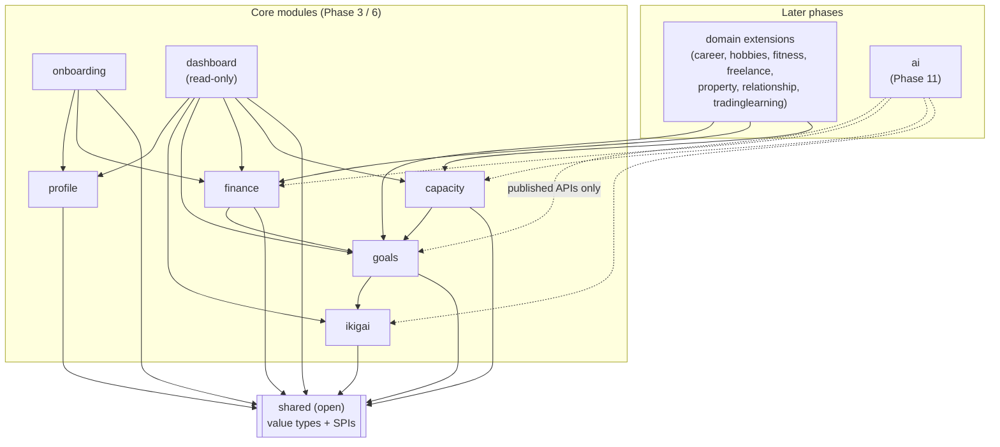

# Domain modules and allowed dependencies (atlas-backend)

- Status: **Proposed** module map (Phase 0). Implemented modules: **none yet**. Phase 1 contains only
  `dev.myatlas.AtlasApplication`; `ModularityTests` verifies the (empty) module model on every build.
- Decisions: [ADR-0002](../adr/0002-modular-monolith-with-spring-modulith.md) (modular monolith),
  [ADR-0004](../adr/0004-database-schema-strategy.md) (table ownership).
- Source: `project-instruction.md` §5–§8, §11.1–§11.4, §12.2–§12.3.

## 1. Module map

Each module is a direct sub-package of `dev.myatlas` and is created with its first feature (no empty
packages). Phase numbers refer to `project-instruction.md` §18.

| Module | Package | Owns | Main public operations | Table prefix | Phase |
|---|---|---|---|---|---|
| `shared` (open) | `dev.myatlas.shared` | Cross-cutting **value types and SPIs only**: `OwnerId`, `CurrentOwner`, `Money`/`CurrencyCode`, `Frequency`, `DatePrecision`/`PlannedDate`, `Clock` access, paging types, base error types, `OwnerDataEraser`/`OwnerDataExporter` SPIs | none (library) | none | 3 |
| `profile` | `dev.myatlas.profile` | Internal user (`owner_id`) and IdP subject mapping, profile, preferences (locale, timezone, currency, units, week start, theme), optional personal context, baseline snapshots, account export/deletion orchestration | Read/update profile and preferences; resolve current owner | `profile_` | 3 |
| `onboarding` | `dev.myatlas.onboarding` | Wizard step state, completion/reopen, baseline-capture workflow (delegates data to owning modules) | Read/save step, complete, reopen | `onboarding_` | 3 |
| `ikigai` | `dev.myatlas.ikigai` | Per-owner Life Dimension (Ikigai area) settings: label, colour token, order, hidden flag for the 7 canonical keys | List/update areas; validate area keys | `ikigai_` | 3 |
| `goals` | `dev.myatlas.goals` | Goals, goal-node tree (MILESTONE/TASK/CHECKPOINT), statuses, progress policy and roll-up, node dependencies + unlock state + overrides, notes, rewards, goal links, goal-area assignment, change log | CRUD goals/nodes, complete/reopen, dependencies, focus tree, progress explanation, timeline read model | `goal_` | 3 |
| `finance` | `dev.myatlas.finance` | Financial baseline (income, expenses, saving positions), goal financial impacts (planned/scenario/committed/realized), scenarios, monthly projection | CRUD baseline, define impact, realize impact, calculate projection | `finance_` | 6 (API draft in 3) |
| `capacity` | `dev.myatlas.capacity` | Weekly availability, time commitments, effort estimates per goal/node, over-capacity detection | Read/update capacity, capacity summary with conflicts | `capacity_` | 6 |
| `dashboard` | `dev.myatlas.dashboard` | **No own business data.** Read-only aggregation of published module read models | Get dashboard view model | none (or `dashboard_` for a persisted read model, only if needed) | 3 (step 7) |
| Domain extensions | `career`, `hobbies`, `fitness`, `freelance`, `property`, `relationship`, `tradinglearning` | Typed details attached to goals/nodes and domain tracking records. **Never a second goal system** | Domain use cases and read models | `career_`, `hobby_`, `fitness_`, `freelance_`, `property_`, `relationship_`, `trading_` | 8 |
| `ai` | `dev.myatlas.ai` | `AiPlanningPort`, provider adapters, versioned suggestion schemas, data-scope selection, suggestion audit and approval | Generate suggestion (dry-run), review, apply via normal use cases | `ai_` | 11 |

UI vocabulary differs from these domain names (Destination = `Goal`, Waypoint/Step = `GoalNode`,
My Atlas = dashboard, ...). See the mapping in [API-CONTRACT §2](API-CONTRACT.md#2-ui-vocabulary-mapping).

### Proposed refinement: goal-to-area assignment is owned by `goals`

§11.3 lists "goal-area assignments" under `ikigai`. This plan proposes that **`goals` owns the
assignment** (`goal_ikigai_area`, part of the Goal aggregate) and references areas by their **stable
canonical key** (`CAREER`, `FINANCE`, `HEALTH`, `LOVE`, `PASSION`, `FRIENDSHIP`, `FAMILY`):

- Goal creation with a primary area and secondary areas (§3.5) stays one atomic use case.
- `ikigai` does not need to know about goals, and `goals` depends only on ikigai's small key-validation
  API, so there is no dependency cycle.
- Area customisation (labels, colours, hidden flags) stays in `ikigai`.

The alternative (ikigai owns assignments) would make ikigai depend on goals' events and split goal
creation into two calls. This is open decision **B-3** in [PLAN-BACKEND](../plan/PLAN-BACKEND.md).

## 2. Internal structure of a module

```text
dev/myatlas/goals/
  package-info.java        # @ApplicationModule(allowedDependencies = {"shared", "ikigai"})
  GoalQueries.java         # published Java API (interface) for other modules (read side)
  GoalSummary.java         # published read DTO (record)
  GoalArchived.java ...    # published domain events (records)
  api/                     # internal: REST controllers, request/response records, API error mapping
  application/             # internal: use cases, transactions, authorization (owner) checks
  domain/                  # internal: entities, value objects, rules (progress, dependency graph)
  infrastructure/          # internal: Spring Data repositories, JPA mappings, adapters
```

Rules (from `project-instruction.md` §11.3–§11.4, enforced where possible):

1. **Published API = module base package** (plus packages explicitly marked `@NamedInterface`). The
   sub-packages `api`, `application`, `domain` and `infrastructure` are internal. Spring Modulith's
   `verify()` fails the build if another module references them.
2. `api` holds REST controllers, request/response DTOs and API error mapping. It calls `application`
   only. **JPA entities are never returned** from controllers.
3. `application` holds use cases. It owns **transaction boundaries** (`@Transactional`) and
   **authorization**: every query/mutation is scoped by the `owner_id` from `CurrentOwner`, never by a
   client-supplied owner.
4. `domain` holds business entities, value objects and rules. Avoid Spring MVC and persistence
   annotations where practical. Domain logic is unit-testable without Spring. Whether JPA annotations sit
   on domain entities or on separate persistence models is a per-module choice; see open decision B-4 in
   PLAN-BACKEND.
5. `infrastructure` holds repositories, JPA mappings and external adapters. **Repositories are never
   used by another module.**
6. A module reads and writes **only its own tables** (ADR-0004). Cross-module data comes through
   published APIs or events.
7. `dashboard` may call published module APIs or read published read models. It must not access other
   modules' repositories.
8. Domain extension modules attach typed details to goals/nodes through goals' published API. They do
   not replace the shared hierarchy (§5.1).
9. `shared` contains no business rules and no persistence. It may not depend on any business module.
10. No dependency cycles between modules (checked by `ApplicationModules.verify()`).

## 3. Allowed dependencies

"Depends on" means it may call the target's published API and listen to its events. Each module declares
its list in `package-info.java` (`@ApplicationModule(allowedDependencies = ...)`), so an undeclared
dependency fails `ModularityTests`.

| Module | May depend on | Must not depend on | Reason |
|---|---|---|---|
| `shared` | (none) | any business module | Foundation types only |
| `profile` | `shared` | everything else | Root of ownership; account deletion/export uses the `shared` SPIs, which every module implements (dependency inversion) |
| `ikigai` | `shared` | `goals` and others | Area settings are independent; defaults are created lazily per owner |
| `goals` | `shared`, `ikigai` | `finance`, `capacity`, `dashboard` | Validates area keys; publishes events for others |
| `finance` | `shared`, `goals` | `capacity`, `dashboard` | Validates goal references; reacts to `GoalArchived`/`GoalDeleted` |
| `capacity` | `shared`, `goals` | `finance`, `dashboard` | Estimates per goal/node; reacts to goal events |
| `onboarding` | `shared`, `profile`, `finance` | `goals`, `ikigai`, `dashboard` | Orchestrates baseline capture (§6.1: preferences, personal context, financial baseline) by calling the owning modules' use cases |
| `dashboard` | `shared`, `profile`, `ikigai`, `goals`, `finance`, `capacity` | (nothing depends on `dashboard`) | Read-only aggregation |
| extensions | `shared`, `goals`, `finance`, `capacity` | each other, `dashboard`, `ai` | Attach to core concepts only |
| `ai` (later) | `shared` + published APIs of the modules it reads/applies | anything internal | Applies approved suggestions only through normal use cases (§8.1) |



## 4. Events

In-process Spring application events (§8.3); no broker. Event types are immutable records in the
publishing module's base package and carry IDs plus `ownerId`, never sensitive values such as amounts or
note text.

| Module | Publishes | Consumed by (planned) |
|---|---|---|
| `profile` | `OwnerRegistered`, `PreferencesChanged` (currency, timezone, week start) | `dashboard` cache invalidation (if any) |
| `onboarding` | `OnboardingCompleted`, `OnboardingReopened` | (frontend reads state; no backend consumer yet) |
| `ikigai` | `IkigaiAreasChanged` | `dashboard` (if cached) |
| `goals` | `GoalCreated`, `GoalUpdated`, `GoalArchived`, `GoalDeleted`, `GoalNodeCompleted`, `GoalNodeReopened`, `GoalDependencyChanged` | `finance` and `capacity` (reference clean-up on archive/delete), `dashboard`, later `ai` audit |
| `finance` | `FinancialBaselineChanged`, `GoalFinancialImpactChanged` | `dashboard` |
| `capacity` | `TimeCapacityChanged` | `dashboard` |

Delivery rules:

- A listener that must stay consistent with the publisher's transaction (for example reference clean-up
  on `GoalDeleted`) runs **synchronously in the same transaction** (`@EventListener` or
  `@TransactionalEventListener(phase = BEFORE_COMMIT)`).
- Side-effect-only listeners (read-model refresh, later notifications) use Spring Modulith's
  `@ApplicationModuleListener` (after commit, in a new transaction). Before the first such listener with
  a durable effect is added, enable the Spring Modulith event publication registry
  (`spring-modulith-starter-jpa`, table set created by Flyway), so failed deliveries are retried and not
  lost. This is open decision B-5.
- Listeners are idempotent.
- No transactional outbox to external systems until there is an external consumer (§8.3).

## 5. Cross-cutting concerns

| Concern | Location | Notes |
|---|---|---|
| Current owner | `shared.security.CurrentOwner` (interface); implementation in `profile` | Maps OIDC `iss` + `sub` to `owner_id` (ADR-0005) |
| Account export / deletion (§12.5) | SPIs `OwnerDataExporter` / `OwnerDataEraser` in `shared`; each module implements them; `profile` orchestrates | `owner_id` FKs with `ON DELETE RESTRICT` prove that deletion was complete (ADR-0004) |
| Error model | `shared.web` base exceptions + global `@RestControllerAdvice` | RFC 9457 Problem Details (ADR-0006) |
| Money and dates | `shared.money`, `shared.time` | `BigDecimal` + ISO 4217; `LocalDate` + `DatePrecision`; `Instant` for events |
| Clock | Injected `java.time.Clock` | No hard-coded dates in business logic (§0.4) |
| Module documentation | Spring Modulith `Documenter` → `target/spring-modulith-docs/` | Generated on every `./mvnw test`, not committed |
