# PLAN-BACKEND: atlas-backend (repository `atlas-microservices`)

- Status: **Phase 0 plan, Proposed**, awaiting owner review. **Phase 1 foundations delivered** on
  2026-11-12 (uncommitted, see [§14](#14-pr-sized-backlog-phases-14)).
- Owner: @hsnrzv
- Phase order and gates: [implementation roadmap](../implementation/roadmap.md).
- Companion documents: [PLAN-DATABASE](PLAN-DATABASE.md),
  [DOMAIN-MODULES](../architecture/DOMAIN-MODULES.md), [API-CONTRACT](../architecture/API-CONTRACT.md),
  [ADR index](../adr/README.md).
- Cross-repository: `atlas` `docs/plan/IMPLEMENTATION-ROADMAP.md` (phase status across repos),
  `atlas` `docs/plan/PLAN-FRONTEND.md`, `atlas` ADR-0002 (repository topology) and ADR-0006 (UI
  vocabulary & domain mapping), `atlas-infra` `docs/plan/PLAN-INFRASTRUCTURE-CICD.md`.
- Source specification: `project-instruction.md` §0, §2, §5, §7, §8, §9.3–§9.6, §11, §12, §13, §16.2,
  §17.2–§17.3, §18, §19, §21.

> The repository is called `atlas-microservices` for historical reasons. It contains **one deployable
> Spring Boot application** (`atlas-backend`), a modular monolith, not microservices (ADR-0002).

## 1. Scope

**In scope of this plan**

- The backend application `atlas-backend`: module structure, layering, cross-cutting concerns (errors,
  security, observability, configuration), build, tests, container image and backend CI.
- A detailed, PR-sized backlog for Phases 1–4 (§18) and an outline of how later phases plug in.
- Database work is planned in [PLAN-DATABASE](PLAN-DATABASE.md). This plan only references it.

**Out of scope**

- Frontend and Capacitor code (`atlas`), Kubernetes manifests, GitOps, hosting, backups and cost
  (`atlas-infra`).
- Detailed design of Phases 5–11 (timeline UI, finance/capacity UI, exports, domain extensions,
  production identity, mobile release, AI). They are listed only where Phase 1–4 choices affect them.

**Phase 1 boundary (respected):** no domain modules, no domain tables, no feature endpoints and no Spring
Security yet (shared contract, user decision 1).

## 2. Current state (Phase 1, delivered 2026-11-12)

| Area | Delivered | Evidence |
|---|---|---|
| Scaffold | Spring Boot **4.2.0** (scaffolded on 4.1.2), Java **25** (scaffolded on 21, moved by [ADR-0008](../adr/0008-java-25-lts-runtime.md)), Maven Wrapper 3.3.4 (Maven **3.10.1** from Maven Central), group `dev.myatlas`, artifact `atlas-backend`, single class `dev.myatlas.AtlasApplication` | `pom.xml`, `mvnw`, `.mvn/wrapper/maven-wrapper.properties` |
| Build rules | `maven-enforcer-plugin` 3.6.3: Java ≥ 25 (`java.version`), Maven ≥ 3.10.1, dependency convergence | `./mvnw -B verify` |
| Modularity | Spring Modulith **2.2.0**; `ModularityTests` runs `ApplicationModules.verify()` and writes module docs to `target/spring-modulith-docs/` | `src/test/java/dev/myatlas/ModularityTests.java` |
| Database | PostgreSQL **18** (`postgres:18.6-alpine`), Flyway 12.11.0 with schema `atlas`, `V1__baseline.sql` (schema comment, no tables), Hibernate `ddl-auto=validate` | `src/main/resources/db/migration/` |
| Configuration | `application.yaml` (common), `application-local.yaml` (plain-text logs, Docker Compose on). No `dev`/`staging`/`prod` files: these environments are configured only through environment variables | `src/main/resources/` |
| Health | `/actuator/health`, `/actuator/health/liveness`, `/actuator/health/readiness`, `/actuator/info`; nothing else exposed; no health details | `AtlasApplicationIT` |
| Errors | Spring MVC Problem Details enabled (`application/problem+json` for framework errors) | `AtlasApplicationIT` |
| Logging | ECS JSON on the console outside `local`; human-readable in `local` | `application*.yaml` |
| Local run | `compose.yaml` (PostgreSQL only, LOCAL ONLY credentials `atlas`/`atlas`/`atlas`, named volume, health check, host port `${ATLAS_DB_PORT:-5432}`), started by `spring-boot-docker-compose` in profile `local` | `README.md` quick start |
| Tests | `ModularityTests` (unit), `AtlasApplicationIT` (Testcontainers PostgreSQL, `@ServiceConnection`, skipped without Docker, mandatory in CI) | `./mvnw -B verify` |
| Image | Multi-stage `Dockerfile`, layered jar (`-Djarmode=tools extract --layers --launcher`), runtime `eclipse-temurin:25-jre-noble`, UID/GID 10001, port 8080 | `docker build` + run against PostgreSQL |
| CI | `backend-ci.yml` (verify, assert integration tests ran, reports on failure, dependency review on PRs) and `backend-container.yml` (buildx build without push + smoke test) | workflow files; not yet run on GitHub (nothing pushed) |
| Hygiene | README, CONTRIBUTING, SECURITY, `.editorconfig`, `.gitattributes`, `.gitignore`, CODEOWNERS, PR template, Dependabot, THIRD-PARTY-NOTICES | repository root, `.github/` |

## 3. Assumptions

1. **One deployable, one database.** `atlas-backend` is the only backend process; PostgreSQL database
   `atlas`, schema `atlas` (shared contract). No message broker, no second service in the MVP (§8.3, §9).
2. **Single user first, owner boundaries from day one** (§12.1, §21.12). Every aggregate carries
   `owner_id`; no sharing or collaboration features are planned.
3. **Same-origin web hosting.** The edge proxy/ingress routes `/api/` to the backend and everything else
   to the frontend (shared contract). Web needs no CORS; Capacitor CORS is decided in Phase 10
   ([API-CONTRACT §13](../architecture/API-CONTRACT.md#13-cors)).
4. **Identity provider: Microsoft Entra External ID** (§21.1, owner decision 2026-11-12; integration in Phase 9).
   Phase 3 still implements a provider-neutral JWT resource server that is tested with signed test tokens
   (ADR-0005); no provider SDK.
5. **No external integrations** (banks, brokers, FX rates, LLMs) in Phases 1–4 (§2, §7.3, §8).
6. **Java 25 LTS and Spring Boot 4.x (currently 4.2)** stay the baseline (ADR-0007, Java part superseded by ADR-0008). Patch/minor updates arrive through
   Dependabot PRs and must pass CI.
7. **Data volume is small** (one user, hundreds of goals/nodes at most). Simplicity beats premature
   optimisation; collection endpoints are still paginated from the start (§11.5).
8. **Time handling:** instants are stored in UTC; business dates are date-only; "today" is computed in
   the owner's timezone preference through an injected `java.time.Clock` (§0.4).

## 4. Architecture

### 4.1 Module map (summary)

The full map, responsibilities, allowed dependencies and the Mermaid diagram are in
[DOMAIN-MODULES](../architecture/DOMAIN-MODULES.md). Summary:

| Module (package `dev.myatlas.*`) | Responsibility | May depend on | Phase |
|---|---|---|---|
| `shared` (open) | Value types and SPIs only (`OwnerId`, `CurrentOwner`, `Money`, `Frequency`, `PlannedDate`, error base types, export/erase SPIs) | — | 3 |
| `profile` | `owner_id` ↔ IdP subject mapping, preferences, personal context, baseline snapshots, account export/deletion orchestration | `shared` | 3 |
| `onboarding` | Wizard step state, complete/reopen; delegates data to owning modules | `shared`, `profile`, `finance` | 3 (finance step: see B-10) |
| `ikigai` | Per-owner settings for the 7 Life Dimension keys | `shared` | 3 |
| `goals` | Goal, goal-node tree, dependencies/unlocks, progress, rewards, notes, links, goal-area assignment, change log, timeline read model | `shared`, `ikigai` | 3 |
| `finance` | Baseline, goal financial impacts, scenarios, projection | `shared`, `goals` | 6 |
| `capacity` | Availability, commitments, planned hours, conflicts | `shared`, `goals` | 6 |
| `dashboard` | Read-only aggregation ("My Atlas") | all core modules | 3 (step 7) |
| `career`, `hobbies`, `fitness`, `freelance`, `property`, `relationship`, `tradinglearning` | Typed details attached to goals/nodes | `shared`, `goals`, `finance`, `capacity` | 8 |
| `ai` | `AiPlanningPort`, adapters, suggestion audit | published APIs only | 11 |

Packages are created together with their first feature. No empty packages exist (Phase 1 has only
`AtlasApplication`).

### 4.2 Layering inside a module

```text
dev/myatlas/<module>/
  package-info.java   @ApplicationModule(allowedDependencies = {...})
  *.java              published API: query/command interfaces, read DTO records, event records
  api/                REST controllers, request/response records, OpenAPI annotations (internal)
  application/        use cases; @Transactional boundaries; owner checks via CurrentOwner (internal)
  domain/             entities, value objects, rules (progress, dependency graph, money) (internal)
  infrastructure/     Spring Data repositories, JPA mapping details, adapters (internal)
```

- `api` → `application` → `domain`; `infrastructure` implements ports defined in `application`/`domain`.
- JPA entities never leave the module and are never serialised by controllers.
- Transactions start in `application`, never in controllers or repositories called directly by
  controllers.
- Business rules live in the backend only (§19, "no business logic duplicated in UI and backend"). The
  API returns derived values (progress, availability, lock reasons) so the frontend does not
  recalculate them.
- Records for DTOs and value objects; no Lombok (B-9). Mapping is hand-written (B-9).
- Enforcement: `ApplicationModules.verify()` (module boundaries, cycles, internal packages). From
  Phase 3, an ArchUnit test (ArchUnit is already on the classpath through Spring Modulith) also checks
  the layer direction inside each module and that `domain` does not import `org.springframework.web..`.

### 4.3 Events

In-process Spring application events, no broker (§8.3). Event types and their consumers are listed in
[DOMAIN-MODULES §4](../architecture/DOMAIN-MODULES.md#4-events).

- Events are immutable records in the publisher's base package. They carry IDs, `ownerId` and the
  occurrence time, never amounts, note text or other personal values.
- Consistency-critical reactions (for example removing finance references when a goal is deleted) run
  synchronously in the publisher's transaction.
- Side-effect reactions use `@ApplicationModuleListener` (after commit, new transaction). The event
  publication registry is enabled before the first durable asynchronous listener exists (B-5).
- Spring Modulith `Scenario` tests verify that use cases publish the expected events.

### 4.4 Error handling

Follows ADR-0006 and [API-CONTRACT §3–§4](../architecture/API-CONTRACT.md#4-errors-rfc-9457-problem-details).

| Source | HTTP | `code` |
|---|---|---|
| Bean Validation / malformed JSON / unknown property / bad enum | 400 | `VALIDATION_FAILED`, `MALFORMED_REQUEST` |
| Missing/invalid authentication | 401 | `UNAUTHENTICATED` |
| Missing scope | 403 | `FORBIDDEN` |
| Unknown ID **or another owner's ID** | 404 | `RESOURCE_NOT_FOUND` |
| Domain state conflict | 409 | `NODE_LOCKED`, `DEPENDENCY_CYCLE`, `CROSS_GOAL_DEPENDENCY`, `INVALID_STATUS_TRANSITION`, `IDEMPOTENCY_IN_PROGRESS` |
| Stale `If-Match` | 412 | `VERSION_CONFLICT` |
| Semantically invalid / key reuse | 422 | `BUSINESS_RULE_VIOLATED`, `IDEMPOTENCY_KEY_REUSED`, `CURRENCY_MISMATCH` |
| Missing `If-Match` | 428 | `PRECONDITION_REQUIRED` |
| JPA `OptimisticLockException` (concurrent write) | 412 | `VERSION_CONFLICT` |
| Unexpected exception | 500 | `INTERNAL_ERROR` (no details; `traceId` only) |

- Domain code throws typed exceptions from `shared` (for example `ResourceNotFound`,
  `BusinessRuleViolation(code)`); one `@RestControllerAdvice` maps them. Controllers contain no
  try/catch for business errors.
- The handler logs `5xx` with stack trace and `4xx` at `DEBUG` without request bodies.
- Error `code` values are part of the API contract (changing one is a breaking change).

### 4.5 Security approach

Decision record: ADR-0005 (Proposed). Implementation is phased:

| Phase | Security work |
|---|---|
| 1 (done) | No Spring Security dependency. Only `health`/`info` actuator endpoints are exposed, without details. Not deployed to any reachable environment. |
| 3 | `spring-boot-starter-security-oauth2-resource-server`: every `/api/**` request authenticated; actuator `health/**` and `info` public; JWT validation of signature, issuer, expiry and audience (`spring.security.oauth2.resourceserver.jwt.issuer-uri` and `.audiences`, both Boot properties); `CurrentOwner` resolves `(iss, sub)` to `owner_id` (just-in-time row in `profile_app_user`); owner-scoped repositories; cross-owner → 404; stateless (no session yet). Local development identity per B-2. |
| 4 | Frontend integration locally through the Angular dev proxy (no CORS). Staging e2e needs the Entra External ID tenant set up early **or** a non-public staging environment (see risk R-2). |
| 9 | BFF for the web (`spring-boot-starter-security-oauth2-client`, Spring Session JDBC, `__Host-` cookie, CSRF), Microsoft Entra External ID integration, threat-model review. |
| 10 | Native PKCE flow; CORS allow-list for Capacitor origins if needed. |

Rules that apply from the first secured endpoint:

- Never accept `ownerId` from the client; never log tokens, request bodies, amounts, notes or health
  values (§13.2).
- Application services always load aggregates **by `(id, owner_id)`**. There is no repository method
  that loads an aggregate root by ID alone (reviewed in PRs; checked by a test that lists repository
  methods per module).
- The test/dev identity can never be active together with the `dev`, `staging` or `prod` profile: the
  application fails to start (verified by a test).
- Security headers: Spring Security defaults (HSTS on HTTPS requests, `X-Content-Type-Options: nosniff`,
  `X-Frame-Options: DENY`, cache-control headers that disable caching of API responses).

### 4.6 Persistence

Details in [PLAN-DATABASE](PLAN-DATABASE.md). Key backend rules:

- Spring Data JPA repositories, internal to the owning module. `JdbcClient` is allowed for module-internal
  read models where JPA is awkward (for example recursive tree queries).
- `ddl-auto=validate` everywhere; Flyway migrations are the only schema source (ADR-0003).
- Optimistic locking with `@Version` on aggregate roots, exposed as `ETag` (API-CONTRACT §7).
- UUIDv7 identifiers generated by the application (Hibernate `@UuidGenerator(style = VERSION_7)`;
  PLAN-DATABASE D-6).
- `open-in-view=false`; read use cases use read-only transactions and explicit fetch plans (no lazy
  loading in controllers).

### 4.7 Observability

| Signal | Phase 1 (done) | Planned |
|---|---|---|
| Health | Liveness/readiness groups; readiness reports `OUT_OF_SERVICE` during graceful shutdown (20 s); overall `/actuator/health` includes the database check | Keep Boot's default probe groups (application state only, no database), so a short PostgreSQL outage does not restart pods; revisit with `atlas-infra` in Phase 9 |
| Logs | ECS JSON on stdout outside `local` (Boot structured logging) | MDC `traceId`/`spanId` once tracing exists; an owner ID hash (not the raw subject) in MDC for support |
| Metrics | Micrometer core through Actuator (no endpoint exposed) | Phase 9: Prometheus or OTLP export, chosen with `atlas-infra` (scrape vs push); `spring-modulith-observability` for module-level spans (optional) |
| Tracing | none | Phase 9: Micrometer Tracing/OpenTelemetry (Boot 4.1 provides `spring-boot-starter-opentelemetry`; exporter target chosen with `atlas-infra`) |
| Audit | none | `goal_change_log` (Phase 3) for user-visible history; AI suggestion audit (Phase 11) |

Logging rules: no request/response body logging; no amounts, notes, health values, tokens or e-mail
addresses at any level; SQL logging off except locally on demand.

### 4.8 Configuration and profiles

| Profile | Where | Configuration source |
|---|---|---|
| `local` | Developer machine | `application-local.yaml`; datasource from `compose.yaml` through Docker Compose support |
| (tests) | `./mvnw verify` | Testcontainers `@ServiceConnection`; Docker Compose support disabled |
| `dev`, `staging`, `prod` | Kubernetes / containers | Environment variables only: `SPRING_PROFILES_ACTIVE`, `SPRING_DATASOURCE_URL`, `SPRING_DATASOURCE_USERNAME`, `SPRING_DATASOURCE_PASSWORD`; from Phase 3 also `SPRING_SECURITY_OAUTH2_RESOURCESERVER_JWT_ISSUERURI` and `SPRING_SECURITY_OAUTH2_RESOURCESERVER_JWT_AUDIENCES` |

- Profile-specific YAML files for `dev`/`staging`/`prod` are added only when they contain more than
  secrets or environment-specific endpoints (none so far).
- Application-specific properties use the prefix `atlas.` and a `@ConfigurationProperties` record with
  validation; `spring-boot-configuration-processor` is added together with the first such record.
- Secrets come from Kubernetes Secrets populated by the secret-management solution chosen in
  `atlas-infra` (§21.10). Never from Git.

### 4.9 Money, dates and determinism

- `Money` = `BigDecimal` (scale ≤ 4) + `CurrencyCode` (ISO 4217); arithmetic only for the same currency;
  `RoundingMode.HALF_EVEN` only at presentation/projection boundaries and documented per calculation.
- `PlannedDate` = `LocalDate` + `DatePrecision` (PLAN-DATABASE D-3).
- `Clock` is a bean; tests use a fixed clock. No `LocalDate.now()` without a clock (checked by ArchUnit
  from Phase 3).

## 5. Proposed packages and files (target at the end of Phase 4)

```text
atlas-microservices/
├── pom.xml, mvnw, mvnw.cmd, .mvn/wrapper/          # Phase 1
├── compose.yaml, Dockerfile, .dockerignore         # Phase 1
├── docs/
│   ├── plan/PLAN-BACKEND.md, PLAN-DATABASE.md      # Phase 0
│   ├── architecture/DOMAIN-MODULES.md, API-CONTRACT.md
│   ├── adr/0000-template.md … 0007-*.md, README.md
│   └── api/openapi.json                            # Phase 3 (committed snapshot, ADR-0006)
├── .github/workflows/backend-ci.yml, backend-container.yml   # Phase 1
│                     openapi-publish.yml                      # Phase 4
└── src/
    ├── main/java/dev/myatlas/
    │   ├── AtlasApplication.java                   # Phase 1
    │   ├── shared/   money/ time/ security/ web/ error/ idempotency/ spi/   # Phase 3 (open module)
    │   ├── profile/  {api,application,domain,infrastructure}/              # Phase 3 step 1
    │   ├── onboarding/ …                                                   # Phase 3 step 1
    │   ├── ikigai/ …                                                       # Phase 3 step 2
    │   ├── goals/ …                                                        # Phase 3 steps 2–6
    │   ├── dashboard/ {api,application}/                                   # Phase 3 step 7
    │   └── config/   SecurityConfiguration, JacksonConfiguration, ClockConfiguration  # Phase 3
    ├── main/resources/
    │   ├── application.yaml, application-local.yaml                         # Phase 1
    │   └── db/migration/V1__baseline.sql, V2__profile_*.sql, …              # PLAN-DATABASE §9
    └── test/java/dev/myatlas/
        ├── ModularityTests.java, AtlasApplicationIT.java, TestcontainersConfiguration.java  # Phase 1
        ├── architecture/LayeringTests.java                                  # Phase 3
        ├── <module>/domain/*Test.java                                       # unit
        ├── <module>/*ModuleIT.java                                          # @ApplicationModuleTest
        ├── <module>/api/*ApiIT.java                                         # HTTP + security + Problem Details
        └── migration/MigrationIT.java                                       # PLAN-DATABASE §10
```

`config` is not a business module. If Spring Modulith detects it as a module, it is declared `OPEN`
or moved into `shared` (decided when created; `ModularityTests` will show it).

## 6. Dependencies

### 6.1 Current (Phase 1)

Managed by `spring-boot-starter-parent` 4.2.0 and `spring-modulith-bom` 2.2.0 (versions as resolved on
2026-11-27; licences in [THIRD-PARTY-NOTICES](../../THIRD-PARTY-NOTICES.md)).

| Dependency | Version | Scope |
|---|---|---|
| `spring-boot-starter-webmvc` (Spring Framework 7.1.0, Tomcat 11.0.27, Jackson 3.1.8) | 4.2.0 | compile |
| `spring-boot-starter-actuator` | 4.2.0 | compile |
| `spring-boot-starter-validation` | 4.2.0 | compile |
| `spring-boot-starter-data-jpa` (Hibernate ORM 7.4.15.Final, HikariCP 7.1.0) | 4.2.0 | compile |
| `spring-boot-starter-flyway` + `flyway-database-postgresql` | 4.2.0 / 12.11.0 | compile |
| `spring-modulith-starter-core` | 2.2.0 | compile |
| `org.postgresql:postgresql` | 42.7.14 | runtime |
| `spring-boot-docker-compose` | 4.2.0 | runtime, optional (excluded from the jar) |
| `spring-boot-starter-webmvc-test` (JUnit 6.1.3, Mockito 5.24.0, AssertJ) | 4.2.0 | test |
| `spring-boot-testcontainers`, `testcontainers-junit-jupiter`, `testcontainers-postgresql` | 4.2.0 / 2.0.5 | test |
| `spring-modulith-starter-test` | 2.2.0 | test |

### 6.2 Planned additions

All versions must be re-verified on Maven Central and against the current Boot version when added; licences go into
THIRD-PARTY-NOTICES in the same PR.

| Dependency | Phase | Purpose | Status (2026-11-12) |
|---|---|---|---|
| `jacoco-maven-plugin` | 1 follow-up | Coverage report (gate from Phase 3) | **Added 2026-11-26 (BE-1.12):** 0.8.16, EPL-2.0 (build/test tool, not packaged) |
| `cyclonedx-maven-plugin` | 1 follow-up | SBOM per build / image | **Added 2026-11-26 (BE-1.13):** 2.9.3 (managed by Boot 4.2.0, which also configures the execution), Apache-2.0 |
| `spring-boot-starter-security-oauth2-resource-server` | 3 | JWT resource server | Boot-managed; the old `spring-boot-starter-oauth2-resource-server` name is deprecated since Boot 4.1 |
| `spring-boot-starter-security-test` | 3 | Security test support (JWT post-processors) | Boot-managed, verified present for 4.1.2 (re-check on 4.2.0 when added) |
| `springdoc-openapi-starter-webmvc-api` | 3 | Code-first OpenAPI (ADR-0006) | 3.2.0, built against Boot 4.1.2, Apache-2.0 |
| `spring-boot-configuration-processor` | 3 | Metadata for `atlas.*` properties | Boot-managed |
| `spring-modulith-starter-jpa` | 3 or 6 (B-5) | Event publication registry | managed by `spring-modulith-bom` 2.2.0 |
| `spring-boot-starter-security-oauth2-client`, `spring-boot-starter-session-jdbc` | 9 | Web BFF (ADR-0005) | Boot-managed |
| `spring-boot-starter-opentelemetry` or Micrometer registry | 9 | Tracing/metrics export | Boot-managed; exporter chosen with `atlas-infra` |

### 6.3 Deliberately not used

| Not used | Reason |
|---|---|
| Lombok | Records cover DTOs/value objects; avoids annotation processing in a Java 25 code base (B-9) |
| MapStruct | Few mappings per module; hand-written mappers are explicit and testable (B-9) |
| H2 / in-memory DB | Tests use real PostgreSQL 18 (ADR-0003) |
| Spring Cloud, service discovery, message brokers | One deployable (ADR-0002, §8.3) |
| `spring-boot-devtools` | Optional per developer; not added to the shared POM |

## 7. Sequence

```mermaid
flowchart LR
    P1["Phase 1<br/>foundations (done)"] --> P2["Phase 2<br/>contract review + decisions<br/>(frontend builds mock UI)"]
    P2 --> F["Phase 3.0<br/>shared, errors, security,<br/>OpenAPI, idempotency/ETag"]
    F --> S1["3.1 profile + onboarding"] --> S2["3.2 ikigai + goal areas"] --> S3["3.3 goal + node tree"]
    S3 --> S4["3.4 dependencies + unlocks"] --> S5["3.5 progress + rewards"] --> S6["3.6 notes + history + links"]
    S6 --> S7["3.7 dashboard + timeline read model"] --> P4["Phase 4<br/>frontend integration, e2e"]
```



- Phase 3 follows the order in §18 exactly. Step 3.0 is a prerequisite introduced by this plan because
  every later step needs owner resolution, the error model and the API conventions.
- Each step ends with: migration(s), domain tests, module test, API tests (incl. cross-owner),
  OpenAPI snapshot update, documentation update.
- Finance and capacity are designed in Phase 3 (API draft, PLAN-DATABASE tables) but implemented in
  Phase 6, as §18 requires.

## 8. Test approach (§17.2)

| Level | Tooling | Naming / location | Runs | What it proves |
|---|---|---|---|---|
| Domain unit | JUnit 6, AssertJ | `*Test`, `<module>/domain` | Surefire (`test`) | Progress roll-up, skipped/cancelled rules, dependency cycle detection, unlock ALL/ANY, reward transitions, money/frequency maths, date precision normalisation |
| Architecture | Spring Modulith `verify()`, ArchUnit | `ModularityTests`, `architecture/*Tests` | Surefire | Module boundaries, no cycles, layering, no unscoped `now()` |
| Module integration | `@ApplicationModuleTest` + Testcontainers | `<module>/*ModuleIT` | Failsafe (`verify`) | Use cases + persistence of one module; published events (`Scenario`) |
| Repository / DB | Testcontainers PostgreSQL 18 | `*ModuleIT`, `migration/MigrationIT` | Failsafe | Constraints, uniqueness, FK behaviour, owner scoping (PLAN-DATABASE §10) |
| API | `MockMvcTester` / `RestTestClient` with full context + Testcontainers | `<module>/api/*ApiIT` | Failsafe | Validation, Problem Details codes, pagination, `ETag`/`If-Match`, idempotency, status codes |
| Security | `spring-security-test` JWT post-processors | `*ApiIT` + `security/*IT` | Failsafe | 401 without token; wrong issuer/audience/expired → 401; cross-owner → 404 for **every** endpoint family |
| Migration | Flyway + Testcontainers | `migration/MigrationIT` | Failsafe | Empty → latest; previous version with representative data → latest |
| Contract | OpenAPI snapshot | `api/OpenApiSnapshotIT` | Failsafe | Generated spec equals `docs/api/openapi.json`; breaking-change check in Phase 4 |
| Container | `backend-container.yml` | CI | PR / main | Image starts against PostgreSQL 18, probes UP, runs as UID 10001 |

- Every `*IT` reuses one PostgreSQL container per JVM (`TestcontainersConfiguration` +
  Spring's context cache) to keep `verify` fast.
- Integration tests are skipped without Docker locally, but CI fails if no `*IT` report exists (the
  "Assert integration tests ran" step).
- Coverage: JaCoCo report from the Phase 1 follow-up; from Phase 3 a gate of **≥ 90 % line and branch
  coverage for `goals.domain`** (progress/dependency rules) and ≥ 80 % line coverage overall (proposed
  thresholds, adjustable at review).

## 9. Security implications

- Personal, financial, health-related and relationship data (§13): owner isolation is the most important
  control. It is enforced in `application` (owner from `CurrentOwner`), in persistence (`owner_id` in
  every aggregate query, FK to `profile_app_user`) and verified by cross-owner tests per endpoint
  family.
- No secrets in the repository. Local credentials `atlas`/`atlas` are marked LOCAL ONLY. CI uses
  throwaway credentials in an isolated Docker network.
- Supply chain: Dependabot (Maven, Actions, Docker, Compose), dependency review on PRs, Maven Wrapper and
  all builds use Maven Central only (no private mirrors referenced). Every build produces a CycloneDX SBOM;
  `backend-container` scans the image with Trivy (fixable critical/high fail) and uploads an image SBOM
  (BE-1.13). Secret scanning with push protection is an owner setting (BE-1.14).
- Container: non-root UID 10001, no shell for the user, no package manager use at runtime, read-only root
  filesystem possible with a writable `/tmp` volume.
- Problem Details never expose stack traces, SQL or personal values.
- Actuator exposes only `health` and `info` without details.
- Threat-model review in Phase 9 (§18), earlier if an environment becomes internet-reachable.

## 10. Deployment implications

Contract for `atlas-infra` (also in README):

| Item | Value |
|---|---|
| Image | `ghcr.io/hsnrzv/atlas-backend` (publishing in Phase 2, BE-2.4, per `atlas-infra` ADR-0007; Phase 1 CI builds without push) |
| Build args | `VERSION`, `REVISION` (Git SHA), `CREATED` (RFC 3339) → OCI labels |
| Port | `8080` |
| User | UID/GID `10001` (`runAsNonRoot: true`, `runAsUser: 10001`) |
| Probes | liveness `/actuator/health/liveness`, readiness and startup `/actuator/health/readiness` |
| Shutdown | graceful, `timeout-per-shutdown-phase: 20s` → `terminationGracePeriodSeconds` ≥ 30 |
| Memory | `JAVA_TOOL_OPTIONS=-XX:MaxRAMPercentage=75 -XX:+ExitOnOutOfMemoryError`; set a memory **limit** so the percentage is meaningful |
| Filesystem | Writable `/tmp` (`emptyDir`) if `readOnlyRootFilesystem: true` |
| Env vars | `SPRING_PROFILES_ACTIVE` (`dev`/`staging`/`prod`), `SPRING_DATASOURCE_URL`, `SPRING_DATASOURCE_USERNAME`, `SPRING_DATASOURCE_PASSWORD`; Phase 3 adds the two JWT variables in §4.8 |
| Database | PostgreSQL 18, database `atlas`; the user needs rights to create schema `atlas` on first start (or the schema is pre-created and owned by it); see PLAN-DATABASE D-4 |
| Migrations | Run at application start (Flyway lock serialises replicas). Moving them to a Job/PreSync hook is B-7 |
| Replicas | 1 is sufficient for the MVP. Several replicas need no code change until the BFF (sessions in JDBC) |

## 11. Risks

| ID | Risk | Likelihood | Impact | Mitigation |
|---|---|---|---|---|
| R-1 | Spring Boot 4.x / Jackson 3 / Hibernate 7 ecosystem gaps (libraries not yet compatible, e.g. springdoc) | Medium | Medium | Verify each addition against the current Boot version before adding; time-boxed spikes in Phase 2 (BE-2.3); keep dependencies minimal |
| R-2 | Phase 4 "e2e tests pass in staging" needs authentication, but the IdP integration is planned for Phase 9 (the IdP itself was decided on 2026-11-12, B-1) | High | High | Set up the Entra External ID tenant and resource-server configuration before Phase 4, **or** keep staging non-public (private network/port-forward) until Phase 9; never enable the dev identity outside `local` |
| R-3 | Owner check forgotten in a new query → data leak between owners | Low (single user first) | High | Owner-scoped repository methods only, cross-owner tests per endpoint family, PR checklist item |
| R-4 | Progress/dependency rules drift between backend and frontend | Medium | Medium | Backend returns derived values (progress, availability, reasons); frontend does not recalculate |
| R-5 | Migration applied at start-up locks or fails during rollout | Low | High | Expand/contract, migration tests from previous version, small migrations; B-7 if migrations get long |
| R-6 | Cross-module references dangle (no cross-module FKs, ADR-0004) | Medium | Low–Medium | Validation through owning module API, synchronous clean-up listeners, optional consistency check query |
| R-7 | Testcontainers tests silently skipped (no Docker) | Medium locally | Medium | CI asserts `*IT` reports exist; README states Docker is required for full verification |
| R-8 | Over-engineering for one user (modules, events, BFF) slows delivery | Medium | Medium | Phase gates, PR-sized backlog, defer registry/BFF/tracing until needed |
| R-9 | Repository visibility/plan unknown: dependency review needs the dependency graph (and GitHub Advanced Security for private repositories) | Medium | Low | Owner checks repository settings (BE-1.14); the job can be made non-blocking if unavailable |

## 12. Measurable acceptance criteria

**Phase 1 (met locally on 2026-11-12):**

- `./mvnw -B verify` with JDK 25 passes (re-verified after the switch from JDK 21, ADR-0008): `ModularityTests` and `AtlasApplicationIT` green, the latter
  against `postgres:18.6-alpine`.
- `atlas.flyway_schema_history` contains version `1` after start-up; `ddl-auto=validate` active.
- `/actuator/health`, `/liveness`, `/readiness` return `200 {"status":"UP"}`; other actuator paths
  return `404`.
- `docker build` succeeds without host `~/.m2` or private mirrors; the container runs as `10001:10001`
  and reports health `UP` against PostgreSQL 18.
- `./mvnw spring-boot:run -Dspring-boot.run.profiles=local` starts PostgreSQL from `compose.yaml` and
  reports health `UP`.
- Workflow files are valid YAML and pass `actionlint`.
- Still open: first green run of both workflows on GitHub (requires a push, which is an owner action).

**Phase 3 (proposed):**

- Every endpoint in API-CONTRACT §9.1–§9.7 marked Phase 3 exists in the generated OpenAPI document,
  which matches the committed snapshot.
- For every Phase 3 endpoint family, automated tests prove: `401` without token, `404` for another
  owner's resource, `400` Problem Details with `VALIDATION_FAILED` for invalid input, `412`/`428` for
  versioned writes.
- Domain tests cover progress roll-up for nested trees (≥ 3 levels) with weights, cancelled and skipped
  nodes, manual policy; dependency cycle rejection; ALL/ANY unlock; override audit.
- `MigrationIT` passes from an empty database and from the previous migration version.
- Coverage thresholds in §8 are met; `ModularityTests` shows the modules `shared`, `profile`,
  `onboarding`, `ikigai`, `goals`, `dashboard` with no violations.

**Phase 4 (proposed):**

- The frontend uses only the HTTP repository against the backend (no demo-only domain data) for
  onboarding, goal CRUD, node CRUD, completion, notes and rewards.
- End-to-end tests pass in staging with authentication (see R-2).
- p95 latency < 300 ms for `GET /dashboard` and `GET /goals/{id}/tree` with a goal of 500 nodes on the
  staging environment (proposed target; measured with a simple load script, not a gate before Phase 9).

## 13. Open decisions

Database decisions D-1…D-9 are in [PLAN-DATABASE §12](PLAN-DATABASE.md#12-open-decisions); API decisions
A-1…A-6 in [API-CONTRACT §14](../architecture/API-CONTRACT.md#14-open-decisions-api).

| ID | Decision | Recommended default | Trade-offs | Decide by |
|---|---|---|---|---|
| B-1 | Identity provider (§21.1) | **Decided 2026-11-12: Microsoft Entra External ID** for deployed environments (free up to 50,000 MAU); provider-neutral configuration; Keycloak only as optional local test IdP (ADR-0005) | Managed: less operations; no SMS factor and no custom sign-in domain without Front Door. Azure AD B2C is closed to new customers. Keycloak: control and parity, but another stateful workload to patch and back up | Decided; tenant set up before staging becomes reachable (R-2), at the latest Phase 9 |
| B-2 | Development identity before the IdP exists | Tests: `spring-security-test` JWT post-processors. Local manual/frontend work: a `local`-only development identity (fixed subject) that is rejected at start-up with any other profile. Optional: Keycloak in `atlas-infra/local` for realistic flows | Fast and simple, but the local flow differs from production until the BFF lands. Keycloak locally is realistic but heavier for daily work | Start of Phase 3 |
| B-3 | Owner of goal-to-area assignment | `goals` owns `goal_ikigai_area` and references stable area keys ([DOMAIN-MODULES §1](../architecture/DOMAIN-MODULES.md#proposed-refinement-goal-to-area-assignment-is-owned-by-goals)) | Atomic goal creation, no cycle; deviates from the §11.3 wording (ikigai "goal-area assignments") | Phase 2 review |
| B-4 | JPA annotations on domain entities or separate persistence models | JPA annotations on aggregate classes in `domain` (pragmatic); pure-Java calculators (progress, dependency graph) operate on plain value objects and have no JPA/Spring imports | Less mapping code; domain is not 100 % persistence-free. Separate models are purer but double the classes for a single-user app | Phase 3.0 |
| B-5 | Event publication registry | Add `spring-modulith-starter-jpa` (tables created by Flyway) together with the first `@ApplicationModuleListener` whose loss would matter; until then only synchronous listeners | Extra tables and completed-event clean-up vs. silently lost asynchronous side effects | When the first async listener is proposed |
| B-6 | OpenAPI approach | Code-first with springdoc + committed snapshot (ADR-0006, A-6) | Fast for one developer; contract-first gives stricter design review but needs generator tooling | Phase 2 review |
| B-7 | Where migrations run | Application start-up (current) for the MVP | Simple, no extra Kubernetes objects; a slow migration delays readiness. A Job/Argo CD PreSync hook separates concerns and allows a separate migration user (D-4) but adds orchestration. Decided with `atlas-infra` | Phase 9 (earlier if a migration > 30 s appears) |
| B-8 | Single-user vs multi-user (§21.12) | Multi-tenant-ready data model (owner everywhere), single-user operation: sign-up is restricted at the IdP (Entra External ID user flow with `isSignUpAllowed: false`; the owner account is created by an admin); no sharing features | Keeps future options open at low cost; restricting access at the IdP keeps the app free of user-management code | Phase 9 with B-1 |
| B-9 | Boilerplate tooling | Java records + hand-written mappers; no Lombok, no MapStruct | More explicit code; fewer build plugins and no annotation-processor coupling to new JDKs | Phase 3.0 |
| B-10 | Onboarding financial-baseline step before the finance module exists (Phase 6) | Phase 3 onboarding has the steps `preferences` and `personal-context`; `financial-baseline` is defined as optional and shown as "available later" until Phase 6, when reopening onboarding lets the user complete it | Keeps Phase 3 small and in §18 order; first-run onboarding is incomplete until Phase 6. Alternative: pull the finance baseline tables forward into Phase 3 | Phase 2 review with PLAN-FRONTEND |
| B-11 | Demo data ("exactly one sample Master's goal in demo mode", §20.2) | Backend seeding is off by default. A property `atlas.demo-data.enabled` (default `false`) creates the sample goal for the current owner through normal use cases; start-up fails if it is `true` with `prod`. Phase 2's sample stays in the frontend mock | Real API data in demos; one more guarded switch. Alternative: frontend-only demo mode, which cannot demo the backend | Phase 4 |
| B-12 | Bounds for the goal tree | Max 500 nodes per goal and depth 10, enforced in the domain and returned as `422` | Protects the unpaginated tree endpoint; limits are initial guesses to revisit with real usage | Phase 3 step 3 |
| B-13 | Dashboard read model | Computed per request from published module queries; no persisted read model or cache | Simple and always consistent; add caching only if the p95 target (§12) is missed | Phase 3 step 7 |

## 14. PR-sized backlog (Phases 1–4)

Each item is one PR unless noted. "DoD" = Definition of Done §19 (PR template). IDs are stable for
cross-referencing from `atlas` `IMPLEMENTATION-ROADMAP.md`.

### Phase 1: foundations

- [x] **BE-1.1** Scaffold from start.spring.io: Boot 4.1.2, Java 21 (moved to Java 25 by ADR-0008), Maven Wrapper (Maven 3.10.0), trimmed
  POM, enforcer (Java/Maven version, dependency convergence).
- [x] **BE-1.2** Configuration: common `application.yaml` (Flyway schema `atlas`, `validate`,
  `open-in-view=false`, Hikari, graceful shutdown, Problem Details, health probes, `health,info` only,
  ECS logs) and `application-local.yaml`.
- [x] **BE-1.3** Local database: `compose.yaml` (`postgres:18.6-alpine`, LOCAL ONLY credentials, health
  check, named volume, `ATLAS_DB_PORT` override), Docker Compose support only in `local`.
- [x] **BE-1.4** Flyway `V1__baseline.sql` (schema conventions, no tables) and migration rules README.
- [x] **BE-1.5** `ModularityTests` (`verify()` + `Documenter` to `target/`).
- [x] **BE-1.6** `AtlasApplicationIT` (Testcontainers PostgreSQL 18: Flyway history in `atlas`, health,
  liveness, readiness, Problem Details for unknown paths); Failsafe for `*IT`.
- [x] **BE-1.7** Multi-stage `Dockerfile` (layered jar, non-root 10001, OCI labels) and allow-list
  `.dockerignore`.
- [x] **BE-1.8** `backend-ci.yml`: verify on PR/main, IT presence assertion, report upload on failure,
  dependency review, least-privilege permissions, concurrency.
- [x] **BE-1.9** `backend-container.yml`: buildx build without push, smoke test with PostgreSQL 18.
- [x] **BE-1.10** Repository hygiene (README, CONTRIBUTING, SECURITY, editor/git attributes, ignore,
  CODEOWNERS, PR template, Dependabot) and THIRD-PARTY-NOTICES.
- [x] **BE-1.11** Phase 0 documents: this plan, PLAN-DATABASE, DOMAIN-MODULES, API-CONTRACT,
  ADR-0001…0007.
- [x] **BE-1.12** JaCoCo report in `verify`, uploaded by CI (no gate yet). Done 2026-11-26: JaCoCo 0.8.16,
  unit and integration data merged into `target/site/jacoco/`; `backend-ci` uploads it (`backend-coverage`) and
  writes a line/branch summary to the job summary.
- [x] **BE-1.13** Supply chain: CycloneDX SBOM in the build and image workflow; container vulnerability
  scan (tool and licence chosen with `atlas-infra`); fail on critical/high without documented exception
  (§19). Done 2026-11-26: Boot-managed CycloneDX 2.9.3 (`META-INF/sbom/application.cdx.json`, uploaded as
  `backend-sbom`); Trivy v0.76.2 in `backend-container` with the same pinned action and policy as `atlas` F2-11
  (fixable CRITICAL/HIGH fail, `.trivyignore` with expiry) plus an image SBOM (`backend-image-sbom`). Trivy is the
  shared-scanner proposal; final confirmation is `atlas-infra` INF-2.0.
- [ ] **BE-1.14** Owner actions on GitHub (not code): push the repository, enable dependency graph,
  Dependabot alerts, secret scanning with push protection, branch protection on `main` requiring
  `backend-ci` and `backend-container`. Pushed to `origin/main` by 2026-11-26; settings and branch protection open.
- [ ] **BE-1.15** First green CI run of both workflows on GitHub (depends on BE-1.14).

### Phase 2: contract alignment (frontend builds the mock-backed shell)

No backend feature code. The backend side of Phase 2 makes Phase 3 unambiguous.

- [ ] **BE-2.1** Review API-CONTRACT §9.1–§9.7 against the frontend mock repository interfaces in
  PLAN-FRONTEND (goal, node tree, focus view, progress, reward, dashboard DTOs); resolve A-1…A-6.
- [ ] **BE-2.2** Owner review of ADR-0004, ADR-0005, ADR-0006 and decisions B-1…B-13, D-1…D-9; update
  statuses to Accepted or revise.
- [ ] **BE-2.3** Time-boxed spike (throwaway branch, ≤ 1 day): springdoc 3.x with Boot 4.2/Jackson 3 for
  records with `Money` (string amount) and `PlannedDate`; JWT resource server with
  `audiences`; report findings in ADR-0006/0005.
- [ ] **BE-2.4** `backend-container.yml` publishes `main-<sha>` to GHCR on `main` (OIDC `GITHUB_TOKEN`
  `packages: write`, provenance, SBOM from BE-1.13, image scan) and opens the bump PR to `atlas-infra`
  `environments/dev` through the GitHub App. Starts once `atlas-infra` ADR-0007 is accepted.

### Phase 3: core backend domain and database (order per §18)

**3.0 Foundations**

- [ ] **BE-3.01** `shared` module (`@ApplicationModule(type = OPEN)`): `OwnerId`, `CurrentOwner`,
  `Money`/`CurrencyCode`, `Frequency`, `DatePrecision`/`PlannedDate`, `Measurement`/`Unit`, `Clock`
  bean, base exceptions; Jackson configuration (money as string, fail on unknown properties); unit tests.
- [ ] **BE-3.02** Error model: global `@RestControllerAdvice`, error `code` catalogue (§4.4), validation
  error list, `traceId` for 5xx; API tests per code.
- [ ] **BE-3.03** Security baseline: resource server, issuer/audience validation, public health/info,
  `CurrentOwner` adapter (owner provisioning lands in BE-3.10), `local` development identity with
  start-up guard (B-2), security tests (401, wrong issuer/audience, expired).
- [ ] **BE-3.04** HTTP conventions support: `ETag`/`If-Match` (412/428), pagination defaults (size 20,
  max 100, sort allow-list), `Idempotency-Key` support component with per-module storage SPI.
- [ ] **BE-3.05** OpenAPI: springdoc, `/v3/api-docs` enabled only in `local`/`dev`, snapshot test,
  `docs/api/openapi.json`, CI artifact.
- [ ] **BE-3.06** Architecture tests (layering, no `now()` without `Clock`) and JaCoCo gates (§8).

**3.1 Profile and onboarding**

- [ ] **BE-3.10** `profile`: `profile_app_user` (issuer, subject → `owner_id`, just-in-time creation),
  `profile_preferences`, `profile_personal_context`; `GET`/`PUT /api/v1/profile`; `OwnerRegistered`,
  `PreferencesChanged`; cross-owner tests.
- [ ] **BE-3.11** `profile_baseline_snapshot`: immutable snapshot of preferences and personal context on
  each confirmed change (finance baseline snapshots join in Phase 6).
- [ ] **BE-3.12** `onboarding`: progress and step state, `GET /onboarding`, `PUT /steps/{stepKey}`
  (delegates to profile), `complete`, `reopen`; `financial-baseline` per B-10.

**3.2 Ikigai and goal areas**

- [ ] **BE-3.20** `ikigai`: lazily created per-owner settings for the 7 canonical keys; `GET`/`PATCH
  /api/v1/ikigai/areas`; published `IkigaiAreaKeys` validation API.

**3.3 Goal aggregate and node tree**

- [ ] **BE-3.30** `goals`: `goal` + `goal_ikigai_area` (primary + secondary with weight); create (title
  only required), list (filters, sort, pagination), detail, patch, archive/restore, permanent delete
  (A-1); goal events.
- [ ] **BE-3.31** `goal_node` tree: create, patch, move (parent/sort order with cycle-free parent
  check), delete subtree (`cascade=true`), `GET /tree`, focus view with breadcrumbs; bounds B-12.

**3.4 Dependencies and unlocks**

- [ ] **BE-3.40** `goal_node_dependency`: add/remove, same-goal rule, cycle detection, unlock condition
  ALL/ANY, derived `availability` with reasons.
- [ ] **BE-3.41** Complete/reopen actions (`409 NODE_LOCKED`, state-idempotent complete, optional
  `Idempotency-Key`); lock override with mandatory reason, audited.

**3.5 Progress and rewards**

- [ ] **BE-3.50** Progress calculator (pure domain): leaf roll-up, weights (default 1), no
  parent/descendant double counting, cancelled excluded, skipped per D-2, manual policy;
  `GET /progress` explanation.
- [ ] **BE-3.51** Rewards: one per goal/node, `PLANNED → EARNED` on completion, `EARNED → REDEEMED` by
  the user; reopening a node reverts `EARNED` to `PLANNED` and leaves `REDEEMED` unchanged (proposed),
  recorded in the change log.

**3.6 Notes, history and links**

- [ ] **BE-3.60** Notes on goals and nodes (Markdown stored as text, size limit, sanitised at render
  time in the frontend).
- [ ] **BE-3.61** `goal_change_log`: status, dates, dependency overrides, progress-policy changes;
  paginated `GET /history`.
- [ ] **BE-3.62** Goal links (`SUPPORTS`, `DEPENDS_ON`, `CONFLICTS_WITH`, `AFFECTS`, `RELATED_TO`), DAG
  check for `DEPENDS_ON`.

**3.7 Dashboard and timeline read model**

- [ ] **BE-3.70** `goals` published query API (`GoalQueries`) and `GET /api/v1/timeline` read model.
- [ ] **BE-3.71** `dashboard`: `GET /api/v1/dashboard` (focus, life balance, active goals, upcoming
  deadlines, recent achievements; `moneySnapshot`/`timeCapacity` = `null` until Phase 6), B-13.

**Phase 3 exit**

- [ ] **BE-3.80** `MigrationIT` from previous version with representative data (PLAN-DATABASE §10).
- [ ] **BE-3.81** Cross-owner/unauthenticated security matrix covering every Phase 3 endpoint family.
- [ ] **BE-3.82** Publish the OpenAPI snapshot for the frontend; update API-CONTRACT to point to it.

### Phase 4: frontend/backend integration

- [ ] **BE-4.1** `openapi-publish.yml`: versioned OpenAPI artifact per main build; breaking-change check
  against the previous snapshot (tool selected and licence-checked).
- [ ] **BE-4.2** Local integration guide: backend `local` profile + Angular dev proxy (`/api` →
  `:8080`) + development identity; documented in README and `atlas` README.
- [ ] **BE-4.3** Behaviour needed by optimistic UI updates: `412` responses carry the current `ETag`;
  idempotent replays return the original response; tests.
- [ ] **BE-4.4** Demo data switch per B-11 (guarded, uses normal use cases).
- [ ] **BE-4.5** Staging readiness with `atlas-infra`: JWT issuer/audience environment variables, database
  credentials from secrets, staging access model per R-2; e2e run green in staging.
- [ ] **BE-4.6** Performance check of dashboard and tree endpoints against the §12 target; record
  results.

### Later phases (outline only)

| Phase | Backend work |
|---|---|
| 5 | Timeline/calendar/chart read models if the Phase 3 timeline endpoint is insufficient |
| 6 | `finance` (baseline, impacts, realise without double counting, scenarios, projection) and `capacity` (availability, commitments, plans, conflicts); onboarding financial step (B-10) |
| 7 | Export data endpoints (rendering choice §21.8 is a frontend/infra topic) |
| 8 | Domain extension modules, one at a time, attaching to goals/finance/capacity |
| 9 | BFF, production IdP, account export/deletion, tracing/metrics export, threat model |
| 10 | Native auth support (CORS/bearer), store release support |
| 11 | `ai` module (dry-run suggestions, audit, apply through use cases) |

## 15. References

- `project-instruction.md` (sections listed at the top), accessed 2026-11-12.
- Spring Boot system requirements: <https://docs.spring.io/spring-boot/system-requirements.html>
  (accessed 2026-11-12).
- Spring Boot application properties (resource server `issuer-uri`, `audiences`):
  <https://docs.spring.io/spring-boot/appendix/application-properties/index.html> (accessed 2026-11-12).
- Spring Modulith reference: <https://docs.spring.io/spring-modulith/reference/> (accessed 2026-11-12).
- Maven Central artifact metadata for the versions in §6 (accessed 2026-11-12).
