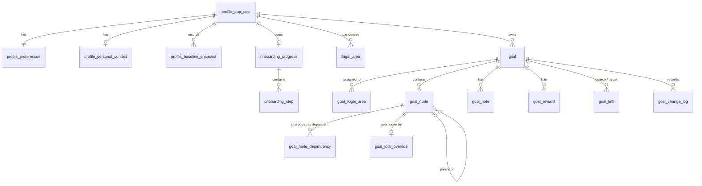

# PLAN-DATABASE: PostgreSQL schema for atlas-backend

- Status: **Phase 0 plan, Proposed**, awaiting owner review. **Phase 1 database foundation delivered**
  on 2026-11-12 (`V1__baseline.sql`, no tables).
- Owner: @hsnrzv
- Companion documents: [PLAN-BACKEND](PLAN-BACKEND.md), [DOMAIN-MODULES](../architecture/DOMAIN-MODULES.md),
  [API-CONTRACT](../architecture/API-CONTRACT.md), [ADR-0003](../adr/0003-postgresql-flyway-jpa.md)
  (PostgreSQL + Flyway + JPA), [ADR-0004](../adr/0004-database-schema-strategy.md) (schema strategy),
  migration rules in [`src/main/resources/db/migration/README.md`](../../src/main/resources/db/migration/README.md).
- Cross-repository: database hosting, backups, RPO/RTO and secrets are owned by `atlas-infra`
  `docs/plan/PLAN-INFRASTRUCTURE-CICD.md` (§21.3, §21.10, §21.11).
- Source specification: `project-instruction.md` §3.5, §5, §6.1, §7, §12, §13, §17.3, §18, §21.

## 1. Scope

**In scope**

- Conventions for every table (§12.1 refined), ownership and schema strategy (§12.3).
- The logical data model for the MVP modules: Phase 3 tables in detail (profile, onboarding, ikigai,
  goals), Phase 6 tables (finance, capacity) as key columns and rules, so that Phase 3 decisions do not
  block them.
- Money, date-precision and unit modelling; progress and dependency data rules.
- Migration strategy, test approach (§17.3), retention/deletion (§12.5), database-side backup and
  security requirements.

**Out of scope**

- Hosting choice (Azure Database for PostgreSQL vs self-hosted, §21.3), backup tooling, retention
  periods, cost: `atlas-infra`.
- Domain extension tables (Phase 8) beyond naming rules.
- The exact final DDL. It is written in the Phase 3/6 migration PRs; this plan fixes names, keys,
  constraints and indexes. The SQL sketch in [§6.4](#64-validated-ddl-sketch-goals) was executed against
  `postgres:18.6-alpine` on 2026-11-12.

## 2. Assumptions

1. One PostgreSQL 18 database `atlas` with the Flyway-managed schema `atlas`; `public` is unused
   (shared contract, ADR-0003).
2. One application (`atlas-backend`) is the only writer. No other service, reporting tool or ETL writes
   to the database.
3. Data volume per owner is small (hundreds of goals, a few thousand nodes, a few hundred finance
   items). Indexes target correctness of owner-scoped queries, not large-scale analytics.
4. Single user first, but every aggregate carries `owner_id` (§12.1, §21.12).
5. Business dates are date-only and never timezone-shifted; instants are stored as `TIMESTAMPTZ` (UTC).
6. No external financial data sources; every amount is user-entered (§6.1, §7).

## 3. Platform, versions and dependencies

| Item | Value (verified 2026-11-12) | Notes |
|---|---|---|
| PostgreSQL | **18**; image `postgres:18.6-alpine` locally, in Testcontainers and in CI | Latest 18.x patch on postgresql.org and Docker Hub on 2026-11-12 was 18.6; re-check per phase (Dependabot updates the Compose tag; majors are ignored) |
| Flyway | 12.4.0 (`spring-boot-starter-flyway` + `flyway-database-postgresql`) | Managed by Spring Boot 4.1.2 |
| JDBC driver | `org.postgresql:postgresql` 42.7.14 | Managed by Spring Boot 4.1.2 |
| ORM | Hibernate ORM 7.4.13.Final via Spring Data JPA, `ddl-auto=validate` | Hibernate never changes the schema |
| Pool | HikariCP 7.0.2, `maximum-pool-size: 10`, `minimum-idle: 2` | `application.yaml` |
| Extensions | **none** | `uuidv7()` is built into PostgreSQL 18 (verified). No `pgcrypto`, `pg_trgm` or `uuid-ossp` needed; a later extension needs a PR that checks availability on the chosen hosting service |
| Test DB | Testcontainers 2.0.5 `testcontainers-postgresql` | No H2 |

## 4. Conventions (§12.1 refined)

| Topic | Rule |
|---|---|
| Names | `snake_case`, singular table names (`goal`, `goal_node`), module prefix (ADR-0004). Unqualified in migrations (`search_path` = `atlas`). |
| Constraint names | `pk_<table>`, `fk_<table>_<target or role>`, `uq_<table>_<cols>`, `ux_<table>_<purpose>` (unique index, e.g. partial), `ck_<table>_<rule>`, `ix_<table>_<cols>`. Named constraints make migration diffs and error mapping stable. |
| Primary keys | `id UUID NOT NULL`, generated by the application as **UUIDv7** (D-6). No database default, so the ID is known before insert; `uuidv7()` is available for manual SQL/backfills. Singleton child tables (1:1 with the owner) use `owner_id` as PK. |
| Ownership | Every aggregate root: `owner_id UUID NOT NULL`, `fk_<table>_owner` → `profile_app_user(id) ON DELETE RESTRICT` (ADR-0004). Also `UNIQUE (owner_id, id)` where another table must prove "same owner" through a composite FK. |
| Audit columns | Aggregate roots and independently editable entities: `created_at TIMESTAMPTZ NOT NULL`, `updated_at TIMESTAMPTZ NOT NULL`, `version BIGINT NOT NULL DEFAULT 0` (JPA `@Version`, exposed as `ETag`). Values come from the application `Clock`, not `now()` defaults, so tests are deterministic. Append-only tables have only `created_at`/`occurred_at`. |
| Enums | `VARCHAR(n)` + `CHECK (col IN (...))`, mapped with `@Enumerated(EnumType.STRING)`. No PostgreSQL `ENUM` types: values cannot be removed from them, which conflicts with expand/contract. Adding a value = new migration replacing the check. |
| Text | Short labels `VARCHAR(n)` with explicit limits (titles 200, descriptions of rewards/links 500); long text `TEXT` with a `CHECK (length(...) <= n)` where a limit protects the API (notes 20,000 characters, proposed). Blank titles are rejected (`CHECK (length(btrim(title)) > 0)`). |
| Money | `amount NUMERIC(19,4)` + `currency VARCHAR(3) CHECK (currency ~ '^[A-Z]{3}$')` in the same row ([§7.1](#71-money)). Never `REAL`/`DOUBLE`/`MONEY`. |
| Dates | `DATE` for business dates, `TIMESTAMPTZ` for instants. Planned dates = `<name>_date DATE` + `<name>_date_precision VARCHAR(12)` ([§7.2](#72-dates-and-date-precision)). |
| Measurements | `<name>_value NUMERIC(p,s)` + `<name>_unit VARCHAR(4)`; both null or both set. |
| Booleans | `BOOLEAN NOT NULL DEFAULT false`; no nullable booleans. |
| JSON | `JSONB` only for immutable snapshots/payloads (change-log details, projection inputs/results, idempotent responses, baseline snapshots). Never for data that is queried or constrained. |
| Foreign keys | Inside a module: real FKs (`ON DELETE CASCADE` for parts of an aggregate, `RESTRICT` otherwise). Across modules: plain `UUID` + index + comment `-- logical reference → <module>` (ADR-0004). Every FK column is indexed (directly or as the leading column of another index). |
| Comments | `COMMENT ON TABLE` with the owning module; `COMMENT ON COLUMN` for logical references and non-obvious units (minutes, weights). |

## 5. Ownership and schema strategy

Proposed in ADR-0004 (open decision D-1): **one schema `atlas`, module-prefixed tables, no cross-module
FKs except `owner_id` → `profile_app_user`.**

| Module | Prefix | Tables (MVP) | Phase |
|---|---|---|---|
| `profile` | `profile_` | `profile_app_user`, `profile_preferences`, `profile_personal_context`, `profile_baseline_snapshot` | 3 |
| `onboarding` | `onboarding_` | `onboarding_progress`, `onboarding_step` | 3 |
| `ikigai` | `ikigai_` | `ikigai_area` | 3 |
| `goals` | `goal`, `goal_` | `goal`, `goal_ikigai_area`, `goal_node`, `goal_node_dependency`, `goal_lock_override`, `goal_note`, `goal_reward`, `goal_link`, `goal_change_log`, `goal_idempotency_key` | 3 |
| `finance` | `finance_` | `finance_income_source`, `finance_expense`, `finance_saving_position`, `finance_goal_impact`, `finance_goal_impact_schedule_item`, `finance_scenario`, `finance_scenario_impact`, `finance_projection_snapshot`, `finance_idempotency_key` | 6 |
| `capacity` | `capacity_` | `capacity_weekly_availability`, `capacity_time_commitment`, `capacity_time_plan` | 6 |
| `dashboard` | `dashboard_` | none (computed per request, PLAN-BACKEND B-13) | — |
| framework | — | `flyway_schema_history` (Phase 1); `spring_session*` (Phase 9 BFF) and the Spring Modulith event publication table (PLAN-BACKEND B-5), both created by Flyway migrations, not by framework auto-initialisers | 1 / later |

Mapping from §12.2 conceptual names: `app_user` → `profile_app_user`; `user_profile` +
`user_preferences` → `profile_app_user.display_name` + `profile_preferences`;
`financial_*` → `finance_*`; `financial_impact` → `finance_goal_impact`; `weekly_capacity` →
`capacity_weekly_availability`; `time_commitment` → `capacity_time_commitment`; `goal_time_estimate` is
split into `goal_node.effort_estimate_minutes` (total effort, owned by goals, §12.2 "effort estimate"
on `goal_node`) and `capacity_time_plan` (planned hours per week, owned by capacity).

Logical cross-module references (no FK, indexed):

| Column | Refers to | Integrity mechanism |
|---|---|---|
| `finance_goal_impact.goal_id`, `.node_id` | `goal`, `goal_node` | Validated via goals' published API on write; synchronous listener on `GoalDeleted` removes/blocks impacts (rule decided in Phase 6: delete planned impacts, keep realised baseline items and clear the link) |
| `capacity_time_plan.goal_id`, `.node_id` | `goal`, `goal_node` | Same; plans of deleted goals/nodes are removed |
| `goal_ikigai_area.area_key` | canonical Life Dimension keys | Fixed key list (`CHECK`); `ikigai` owns only per-owner display settings |

## 6. Data model

### 6.1 Overview (Phase 3)



`goal_node`, notes and rewards can also reference a node (`node_id`), not shown to keep the diagram
readable.

### 6.2 Phase 3 tables

Common columns (`created_at`, `updated_at`, `version`) are omitted unless relevant. "FK owner" =
`owner_id UUID NOT NULL` → `profile_app_user(id) ON DELETE RESTRICT`.

**profile**

| Table | Key columns | Constraints and indexes |
|---|---|---|
| `profile_app_user` | `id` (= `owner_id` everywhere), `issuer VARCHAR(255)`, `subject VARCHAR(255)`, `display_name VARCHAR(100) NULL`, audit columns | `uq_profile_app_user_issuer_subject (issuer, subject)`. Created just-in-time on the first authenticated request. No e-mail or name copied from the token unless a feature needs it. |
| `profile_preferences` | PK/FK `owner_id` (CASCADE inside module), `locale VARCHAR(35)` (BCP 47), `timezone VARCHAR(64)` (IANA), `currency VARCHAR(3)`, `week_start VARCHAR(9)`, `measurement_system VARCHAR(8)` (`METRIC`/`IMPERIAL`), `theme VARCHAR(6)` (`SYSTEM`/`LIGHT`/`DARK`) | Checks for the enum columns and currency format; locale/timezone validated in the application (Java `Locale`/`ZoneId`). Defaults from the device are suggestions (§6.1); EUR is the initial currency default. Notification preferences are added when notifications exist. |
| `profile_personal_context` | PK/FK `owner_id`, `height_value NUMERIC(5,1)`, `height_unit` (`CM`/`IN`), `weight_value NUMERIC(5,1)`, `weight_unit` (`KG`/`LB`), `relationship_status VARCHAR(32) NULL` | Value and unit both null or both set; values > 0. All columns optional (§6.1). Relationship status values are a neutral, editable list agreed with PLAN-FRONTEND. |
| `profile_baseline_snapshot` | `id`, FK owner, `captured_at TIMESTAMPTZ`, `reason VARCHAR(24)` (`ONBOARDING_COMPLETED`, `PROFILE_CHANGED`), `schema_version SMALLINT`, `payload JSONB` | Append-only; `ix_profile_baseline_snapshot_owner_captured (owner_id, captured_at DESC)`. Holds preferences + personal context at that time (D-7). |

The aggregate root is `profile_app_user`; `PUT /api/v1/profile` updates preferences and personal
context under the root's `version`.

**onboarding**

| Table | Key columns | Constraints and indexes |
|---|---|---|
| `onboarding_progress` | PK/FK `owner_id` (FK owner), `status VARCHAR(12)` (`NOT_STARTED`, `IN_PROGRESS`, `COMPLETED`), `completed_at`, `reopened_at`, audit columns | `ck`: `completed_at` set iff `status = 'COMPLETED'`. |
| `onboarding_step` | PK (`owner_id`, `step_key VARCHAR(40)`), FK → `onboarding_progress` CASCADE, `status VARCHAR(12)` (`NOT_STARTED`, `COMPLETED`, `SKIPPED`), `updated_at` | `ck_onboarding_step_key CHECK (step_key ~ '^[a-z][a-z0-9-]*$')`; the list of valid keys (`preferences`, `personal-context`, `financial-baseline`) lives in code because it grows with modules. Step **data** is stored by the owning module, not here. |

**ikigai**

| Table | Key columns | Constraints and indexes |
|---|---|---|
| `ikigai_area` | PK (`owner_id`, `area_key VARCHAR(16)`), FK owner, `label VARCHAR(60) NULL` (null = not customised), `color_token VARCHAR(40) NULL` (null = default token), `sort_order SMALLINT`, `hidden BOOLEAN`, audit columns | `ck_ikigai_area_key` = the 7 canonical keys (`CAREER`, `FINANCE`, `HEALTH`, `LOVE`, `PASSION`, `FRIENDSHIP`, `FAMILY`). Rows are created lazily per owner (`INSERT … ON CONFLICT DO NOTHING`). When `label` is null, the API returns the canonical default label; localisation of default labels is coordinated with PLAN-FRONTEND. Keys are never renamed. |

**goals** (DDL sketch for the central tables in [§6.4](#64-validated-ddl-sketch-goals))

| Table | Key columns | Constraints and indexes |
|---|---|---|
| `goal` | `id`, FK owner, `title`, `outcome`, `description`, `status` (`DRAFT`, `ACTIVE`, `PAUSED`, `COMPLETED`, `ARCHIVED`), `status_before_archive` (for restore), `priority` (`LOW`/`MEDIUM`/`HIGH`, proposed), `start_date`(+precision), `target_date`(+precision), `expected_weekly_effort_minutes`, `progress_policy` (`DERIVED`/`MANUAL`), `manual_progress_percent NUMERIC(4,1)`, `completed_at`, `archived_at`, audit columns | `uq_goal_owner_id_id (owner_id, id)` for same-owner composite FKs; `archived_at` iff `ARCHIVED`; date order; precision normalisation; `ix_goal_owner_status`, `ix_goal_owner_target_date`. Free-text filter `q` uses `ILIKE` on the owner's goals (small data, no extension). |
| `goal_ikigai_area` | PK (`goal_id`, `area_key`), FK goal CASCADE, `role` (`PRIMARY`/`SECONDARY`), `weight NUMERIC(4,3) NULL` (0 < w ≤ 1, optional contribution weight) | `ux_goal_ikigai_area_primary` (one primary per goal, partial unique index); `ix_goal_ikigai_area_key (area_key, goal_id)` for the `area` filter. |
| `goal_node` | `id`, `goal_id` FK CASCADE, `parent_id NULL`, `node_type` (`MILESTONE`, `TASK`, `CHECKPOINT`), `title`, `outcome`, `description`, `status` (`NOT_STARTED`, `IN_PROGRESS`, `COMPLETED`, `SKIPPED`, `CANCELLED`), `start_date`/`due_date` (+precision), `effort_estimate_minutes`, `progress_weight NUMERIC(7,3) DEFAULT 1` (> 0), `progress_policy`, `manual_progress_percent`, `unlock_condition` (`ALL` default / `ANY`), `sort_order`, `completed_at`, audit columns | `uq_goal_node_goal_id_id (goal_id, id)`; **parent in the same goal** via composite FK `(goal_id, parent_id)` → `(goal_id, id)` CASCADE (deleting a node deletes its subtree); `completed_at` iff `COMPLETED`; `ix_goal_node_tree (goal_id, parent_id, sort_order)`; partial `ix_goal_node_due_date`. No stored lock/blocked status (§5.3). |
| `goal_node_dependency` | `id`, `goal_id`, `prerequisite_node_id`, `dependent_node_id`, `created_at` | **Same goal enforced by the database**: both node columns use composite FKs with `goal_id` (CASCADE); `uq` on the pair; `ck` not self. Cycles are rejected by the application ([§8.2](#82-dependencies-and-unlocks)). |
| `goal_lock_override` | `id`, `goal_id`, `node_id` (composite FK CASCADE), `reason TEXT NOT NULL` (1–1,000 chars), `created_at`, `revoked_at NULL` | `ux_goal_lock_override_active (node_id) WHERE revoked_at IS NULL`: at most one active override per node; history stays in the table and in `goal_change_log` (§5.5). |
| `goal_note` | `id`, `goal_id` FK CASCADE, `node_id NULL` (composite FK CASCADE), `body TEXT` (≤ 20,000), `format` (`PLAIN`/`MARKDOWN`), audit columns | `ix_goal_note_goal_node (goal_id, node_id, created_at)`. Markdown stored raw; sanitised on rendering (frontend). The spec's "visibility scope" column is not added until a second visibility level exists; exports use their own inclusion flags (Phase 7). |
| `goal_reward` | `id`, `goal_id` FK CASCADE, `node_id NULL` (composite FK CASCADE), `description VARCHAR(500)`, `status` (`PLANNED`, `EARNED`, `REDEEMED`), `earned_at`, `redeemed_at`, audit columns | `ck` timestamp/status consistency; `ux_goal_reward_goal_level (goal_id) WHERE node_id IS NULL`; `ux_goal_reward_node (node_id) WHERE node_id IS NOT NULL` (one reward per goal/node). |
| `goal_link` | `id`, FK owner, `source_goal_id`, `target_goal_id`, `link_type` (`SUPPORTS`, `DEPENDS_ON`, `CONFLICTS_WITH`, `AFFECTS`, `RELATED_TO`), `description`, `effective_from`, `effective_to`, audit columns | **Same owner enforced**: composite FKs `(owner_id, source_goal_id)`/`(owner_id, target_goal_id)` → `goal (owner_id, id)` CASCADE; `uq (source, target, type)`; not self; period order; `ix_goal_link_target`. No cycles for `DEPENDS_ON` (application). |
| `goal_change_log` | `id`, `goal_id` FK CASCADE, `node_id NULL` (**no FK**, so history survives node deletion), `change_type VARCHAR(40)`, `details JSONB` (old/new values of structured fields only; never note text), `actor_owner_id`, `occurred_at` | Append-only; `ix_goal_change_log_goal_time (goal_id, occurred_at DESC)`. Types: status, dates, dependency added/removed, lock override/revoke, progress policy, reward status, node moved/deleted. |
| `goal_idempotency_key` | PK (`owner_id`, `endpoint VARCHAR(100)`, `idempotency_key UUID`), FK owner, `request_hash VARCHAR(64)` (SHA-256 hex), `state` (`IN_PROGRESS`/`COMPLETED`), `response_status SMALLINT`, `response_body JSONB`, `resource_id UUID`, `created_at`, `expires_at` | `ix_goal_idempotency_key_expires (expires_at)` for purge. 24 h lifetime (API-CONTRACT §8). |

### 6.3 Phase 6 tables (key columns; refined in Phase 6)

| Table | Key columns and rules |
|---|---|
| `finance_income_source` | FK owner, `name`, `kind` (`EMPLOYMENT`, `FREELANCE`, `RENTAL`, `OTHER`), money, `frequency`, `basis` (`GROSS`/`NET`/`UNKNOWN`, never assumed), `effective_from DATE NOT NULL`, `effective_to NULL`, `origin_impact_id UUID NULL UNIQUE` → `finance_goal_impact` |
| `finance_expense` | FK owner, `category VARCHAR(40)` (rent, groceries, internet, insurance, … from §6.1; multiple insurance rows allowed), money, `frequency`, effective dates, `notes`, `origin_impact_id NULL UNIQUE` |
| `finance_saving_position` | FK owner, `category` (e.g. `EMERGENCY_RESERVE`, `ETF`, `STOCK`, `CASH`, `OTHER`), `kind` (`BALANCE`/`CONTRIBUTION`), money, `frequency` (contributions only), `valuation_date DATE NOT NULL`, `origin_impact_id NULL UNIQUE` |
| `finance_goal_impact` | FK owner, `goal_id` / `node_id` (logical), `category` (`INCOME`, `EXPENSE`, `SAVINGS`, `ASSET`, `LIABILITY`, `DEBT_SERVICE`, `ONE_TIME_COST`), money, `amount_low`/`amount_high` (optional confidence range, same currency, low ≤ amount ≤ high), `frequency` (`ONE_TIME`, `WEEKLY`, `MONTHLY`, `QUARTERLY`, `YEARLY`, `CUSTOM`), `effective_from`/`effective_to` (+precision), `state` (`PLANNED`, `SCENARIO`, `COMMITTED`, `REALIZED`), `realized_at` iff `REALIZED`, `notes`, `account_category NULL`; `uq (id, currency)` for the schedule FK; `ix (owner_id, goal_id)` |
| `finance_goal_impact_schedule_item` | For `CUSTOM` frequency (e.g. a degree costing EUR 1,000 over 2.5 years, §7.2): `impact_id` + `currency` composite FK → `finance_goal_impact (id, currency)` CASCADE (forces the same currency), `due_date`, `amount` |
| `finance_scenario` / `finance_scenario_impact` | Named scenario (FK owner, `name`, `assumption_notes`) and its selected impacts (PK pair, CASCADE) |
| `finance_projection_snapshot` | FK owner, `scenario_id NULL`, `generated_at`, `period_from DATE`, `months SMALLINT`, `calculation_version VARCHAR(20)`, `inputs JSONB` (IDs + versions + values used), `result JSONB`. A cache with provenance, never the source of truth (§12.2, §12.4) |
| `finance_idempotency_key` | Same structure as `goal_idempotency_key` |
| `capacity_weekly_availability` | FK owner, `effective_from DATE`, `mode` (`PER_WEEKDAY`/`WEEKLY_TOTAL`), `total_minutes NULL`, per-weekday minutes columns (0–1,440); `uq (owner_id, effective_from)` |
| `capacity_time_commitment` | FK owner, `title`, `recurrence` (`WEEKLY`/`ONE_TIME`), `day_of_week NULL`, `minutes`, `effective_from`/`effective_to` |
| `capacity_time_plan` | FK owner, `goal_id`/`node_id` (logical), `planned_minutes_per_week` (> 0), `period_from DATE`, `period_to NULL`; `ix (owner_id, goal_id)` |

### 6.4 Validated DDL sketch (goals)

The statements below were executed against `postgres:18.6-alpine` on 2026-11-12 (after a minimal
`profile_app_user`), together with negative tests. A fuller sketch with the other goals tables and a
finance impact/baseline pair was checked the same way. Rejected as intended:

- a `MONTH` date on the 15th;
- a second primary area;
- a parent or dependency in another goal;
- a link to another owner's goal;
- a completed node without `completed_at`;
- a manual percent on a `DERIVED` node;
- an `EARNED` reward without `earned_at`;
- deleting an owner that still has data;
- a second baseline item for the same realised impact.

Subtree and goal deletion cascaded as intended. The final DDL is written in the Phase 3 migration PRs.

```sql
CREATE TABLE goal (
    id                      UUID          NOT NULL,
    owner_id                UUID          NOT NULL,
    title                   VARCHAR(200)  NOT NULL,
    status                  VARCHAR(10)   NOT NULL DEFAULT 'DRAFT',
    status_before_archive   VARCHAR(10),
    start_date              DATE,
    start_date_precision    VARCHAR(12),
    target_date             DATE,
    target_date_precision   VARCHAR(12),
    progress_policy         VARCHAR(8)    NOT NULL DEFAULT 'DERIVED',
    manual_progress_percent NUMERIC(4, 1),
    completed_at            TIMESTAMPTZ,
    archived_at             TIMESTAMPTZ,
    created_at              TIMESTAMPTZ   NOT NULL,
    updated_at              TIMESTAMPTZ   NOT NULL,
    version                 BIGINT        NOT NULL DEFAULT 0,
    -- outcome, description, priority, expected_weekly_effort_minutes and the start-date checks omitted
    CONSTRAINT pk_goal PRIMARY KEY (id),
    CONSTRAINT uq_goal_owner_id_id UNIQUE (owner_id, id),
    CONSTRAINT fk_goal_owner FOREIGN KEY (owner_id) REFERENCES profile_app_user (id) ON DELETE RESTRICT,
    CONSTRAINT ck_goal_title_not_blank CHECK (length(btrim(title)) > 0),
    CONSTRAINT ck_goal_status CHECK (status IN ('DRAFT', 'ACTIVE', 'PAUSED', 'COMPLETED', 'ARCHIVED')),
    CONSTRAINT ck_goal_status_before_archive
        CHECK (status_before_archive IN ('DRAFT', 'ACTIVE', 'PAUSED', 'COMPLETED')),
    CONSTRAINT ck_goal_archived CHECK ((status = 'ARCHIVED') = (archived_at IS NOT NULL)),
    CONSTRAINT ck_goal_completed CHECK (status <> 'COMPLETED' OR completed_at IS NOT NULL),
    CONSTRAINT ck_goal_progress_policy CHECK (progress_policy IN ('DERIVED', 'MANUAL')),
    CONSTRAINT ck_goal_manual_progress CHECK (manual_progress_percent IS NULL
        OR (progress_policy = 'MANUAL' AND manual_progress_percent BETWEEN 0 AND 100)),
    CONSTRAINT ck_goal_target_date_precision CHECK ((target_date IS NULL) = (target_date_precision IS NULL)),
    CONSTRAINT ck_goal_target_date_normalised CHECK (
        target_date_precision IS NULL
        OR target_date_precision IN ('DAY', 'APPROXIMATE')
        OR (target_date_precision = 'MONTH' AND extract(DAY FROM target_date) = 1)
        OR (target_date_precision = 'QUARTER' AND extract(DAY FROM target_date) = 1
            AND extract(MONTH FROM target_date) IN (1, 4, 7, 10))
        OR (target_date_precision = 'YEAR' AND extract(DAY FROM target_date) = 1
            AND extract(MONTH FROM target_date) = 1)),
    CONSTRAINT ck_goal_date_order CHECK (start_date IS NULL OR target_date IS NULL OR start_date <= target_date)
);
CREATE INDEX ix_goal_owner_status ON goal (owner_id, status);
CREATE INDEX ix_goal_owner_target_date ON goal (owner_id, target_date);

CREATE TABLE goal_node (
    id                      UUID          NOT NULL,
    goal_id                 UUID          NOT NULL,
    parent_id               UUID,
    node_type               VARCHAR(10)   NOT NULL,
    title                   VARCHAR(200)  NOT NULL,
    status                  VARCHAR(12)   NOT NULL DEFAULT 'NOT_STARTED',
    due_date                DATE,
    due_date_precision      VARCHAR(12),
    effort_estimate_minutes INTEGER,
    progress_weight         NUMERIC(7, 3) NOT NULL DEFAULT 1,
    progress_policy         VARCHAR(8)    NOT NULL DEFAULT 'DERIVED',
    manual_progress_percent NUMERIC(4, 1),
    unlock_condition        VARCHAR(3)    NOT NULL DEFAULT 'ALL',
    sort_order              INTEGER       NOT NULL,
    completed_at            TIMESTAMPTZ,
    created_at              TIMESTAMPTZ   NOT NULL,
    updated_at              TIMESTAMPTZ   NOT NULL,
    version                 BIGINT        NOT NULL DEFAULT 0,
    -- outcome, description, start_date(+precision) omitted for brevity
    CONSTRAINT pk_goal_node PRIMARY KEY (id),
    CONSTRAINT uq_goal_node_goal_id_id UNIQUE (goal_id, id),
    CONSTRAINT fk_goal_node_goal FOREIGN KEY (goal_id) REFERENCES goal (id) ON DELETE CASCADE,
    CONSTRAINT fk_goal_node_parent FOREIGN KEY (goal_id, parent_id)
        REFERENCES goal_node (goal_id, id) ON DELETE CASCADE,
    CONSTRAINT ck_goal_node_not_own_parent CHECK (parent_id <> id),
    CONSTRAINT ck_goal_node_title_not_blank CHECK (length(btrim(title)) > 0),
    CONSTRAINT ck_goal_node_type CHECK (node_type IN ('MILESTONE', 'TASK', 'CHECKPOINT')),
    CONSTRAINT ck_goal_node_status CHECK (status IN ('NOT_STARTED', 'IN_PROGRESS', 'COMPLETED', 'SKIPPED', 'CANCELLED')),
    CONSTRAINT ck_goal_node_completed CHECK ((status = 'COMPLETED') = (completed_at IS NOT NULL)),
    CONSTRAINT ck_goal_node_weight CHECK (progress_weight > 0),
    CONSTRAINT ck_goal_node_progress_policy CHECK (progress_policy IN ('DERIVED', 'MANUAL')),
    CONSTRAINT ck_goal_node_manual_progress CHECK (manual_progress_percent IS NULL
        OR (progress_policy = 'MANUAL' AND manual_progress_percent BETWEEN 0 AND 100)),
    CONSTRAINT ck_goal_node_effort CHECK (effort_estimate_minutes >= 0),
    CONSTRAINT ck_goal_node_unlock_condition CHECK (unlock_condition IN ('ALL', 'ANY')),
    CONSTRAINT ck_goal_node_due_precision CHECK ((due_date IS NULL) = (due_date_precision IS NULL))
);
CREATE INDEX ix_goal_node_tree ON goal_node (goal_id, parent_id, sort_order);
CREATE INDEX ix_goal_node_due_date ON goal_node (goal_id, due_date) WHERE due_date IS NOT NULL;

CREATE TABLE goal_node_dependency (
    id                   UUID        NOT NULL,
    goal_id              UUID        NOT NULL,
    prerequisite_node_id UUID        NOT NULL,
    dependent_node_id    UUID        NOT NULL,
    created_at           TIMESTAMPTZ NOT NULL,
    CONSTRAINT pk_goal_node_dependency PRIMARY KEY (id),
    CONSTRAINT fk_goal_node_dependency_prerequisite FOREIGN KEY (goal_id, prerequisite_node_id)
        REFERENCES goal_node (goal_id, id) ON DELETE CASCADE,
    CONSTRAINT fk_goal_node_dependency_dependent FOREIGN KEY (goal_id, dependent_node_id)
        REFERENCES goal_node (goal_id, id) ON DELETE CASCADE,
    CONSTRAINT uq_goal_node_dependency_pair UNIQUE (prerequisite_node_id, dependent_node_id),
    CONSTRAINT ck_goal_node_dependency_not_self CHECK (prerequisite_node_id <> dependent_node_id)
);
CREATE INDEX ix_goal_node_dependency_dependent ON goal_node_dependency (goal_id, dependent_node_id);
```

Composite FKs with a nullable column (`parent_id`, `node_id`) are not checked when that column is
null (PostgreSQL default `MATCH SIMPLE`), which is exactly what top-level nodes and goal-level
notes/rewards need. Hibernate maps `parent_id` as a normal association; the composite FK is an extra
database guarantee that `ddl-auto=validate` does not need to know about.

## 7. Modelling rules

### 7.1 Money

- `NUMERIC(19,4)`: up to 15 integer digits and 4 decimals; covers all ISO 4217 minor units (0–4). The
  API accepts at most 13 integer digits (API-CONTRACT §5), so values always fit.
- The currency is stored in **every** row that has an amount; there is no implicit owner currency in
  calculations. Sums across currencies are rejected (`CURRENCY_MISMATCH`) until an explicit exchange
  rate with valuation date exists (§7.3).
- Currency code: `VARCHAR(3)` with an upper-case format check. `CHAR(3)` is not used: PostgreSQL
  recommends `text`/`varchar` over `character(n)`, and it avoids a blank-padded type next to Java
  `String` in Hibernate schema validation. Whether the code is an active ISO 4217 code is checked in the
  application (`java.util.Currency`).
- Sign convention: user-entered amounts are stored as **non-negative** (`CHECK (amount >= 0)`); the
  direction comes from the category/kind (income vs expense). This prevents double negation errors in
  projections. Negative values exist only in calculated results (e.g. net cash flow in a projection).
- Recurring amounts carry `frequency` + `effective_from` (+ optional `effective_to`). `CUSTOM` uses
  schedule rows; a total cost over a period is never turned into a monthly amount implicitly (§7.2
  example 2).
- Planned vs actual (§7.2 critical rule): baseline tables (`finance_income_source`, `finance_expense`,
  `finance_saving_position`) contain **actuals only**. Impacts never change baseline rows. "Realise"
  creates or links one baseline row with `origin_impact_id` (unique) and sets the impact to `REALIZED`
  in the same transaction. Projections count baseline rows plus impacts in `PLANNED`/`SCENARIO`/
  `COMMITTED` state (per scenario selection) and **exclude `REALIZED` impacts**, so nothing is counted
  twice.

### 7.2 Dates and date precision

Proposed model (D-3), shared by API and database:

| Precision | Stored `date` | Meaning | Latest day (for overdue checks) |
|---|---|---|---|
| `DAY` | the day | exact date | same day |
| `MONTH` | 1st of month | some time in that month | last day of month |
| `QUARTER` | 1st of Jan/Apr/Jul/Oct | some time in that quarter | last day of quarter |
| `YEAR` | 1 January | some time in that year | 31 December |
| `APPROXIMATE` | best-estimate day | "around" this date, shown as approximate | same day |

- The database enforces normalisation (`ck_<table>_<col>_normalised`, see `ck_goal_target_date_normalised`
  in [§6.4](#64-validated-ddl-sketch-goals)) and
  that date and precision are both null or both set. The domain type `PlannedDate` computes earliest and
  latest day; "overdue" means `today > latest` in the owner's timezone.
- Ranges are expressed by two planned dates (start and target/due), each with its own precision.
- "Season" is not supported in the MVP because it depends on the hemisphere (D-3).
- `DATE` values are mapped to `LocalDate` and never converted through a timezone. Instants are mapped to
  `Instant` ↔ `TIMESTAMPTZ`. The JVM default timezone is never used for business logic.

### 7.3 Units and personal data

- Measurements are stored as value + unit; conversion happens only for display or explicit comparison.
- Personal context (§6.1) is optional and minimal. No partner identity, medical records, bank or broker
  credentials are ever stored (§6.1, §6.4).

## 8. Progress and dependency data rules

### 8.1 Progress (§5.4, open decision D-2)

Progress is **computed on read** from the node tree and never stored (D-8): a goal is bounded to
500 nodes (PLAN-BACKEND B-12), so the calculation is cheap and can never drift from the data.

Proposed rules (recommended default for D-2):

1. A **leaf** (node without counted children) contributes `1` if `COMPLETED`, otherwise `0`. With
   `progress_policy = MANUAL`, a leaf contributes `manual_progress_percent / 100` (the explicit way to
   record partially completed work, §21.6).
2. A **parent** with `DERIVED` policy has progress = Σ(wᵢ × pᵢ) / Σ(wᵢ) over its **counted** children,
   where w = `progress_weight` (default 1). Its own status is not counted (no double counting).
   A parent with `MANUAL` policy uses its `manual_progress_percent` and ignores its children.
3. `CANCELLED` nodes (and their subtrees) are **excluded** from numerator and denominator.
4. `SKIPPED` nodes are **excluded like cancelled** ones, but the explanation lists them separately
   ("2 skipped"). Alternative: count skipped as done (progress jumps although no work was done), or as
   not done (progress can never reach 100 %).
5. A node whose children are all excluded is itself excluded from its parent. A goal with no counted
   nodes has progress `null` ("nothing to measure"), unless the goal uses `MANUAL` policy or is
   `COMPLETED` (100 %).
6. Results are computed with `BigDecimal`, rounded half-even to one decimal for the API
   (`"42.5"`). The explanation returns the policy, weights, counted/excluded node IDs and the formula
   inputs per level.
7. Completing a parent whose counted descendants are not all completed returns
   `409 INVALID_STATUS_TRANSITION`, unless the request explicitly asks to complete the open
   descendants as well (proposed; API detail settled in Phase 3).

### 8.2 Dependencies and unlocks

- Same-goal only (§5.5): enforced by composite FKs (§6.4) and checked in the application for a clear
  `409 CROSS_GOAL_DEPENDENCY` error before the database rejects it.
- No cycles: before inserting `(prerequisite → dependent)`, the application checks that `dependent` cannot
  already reach `prerequisite` (DFS over the goal's dependency edges, loaded in one query). To avoid two
  concurrent inserts forming a cycle, every structural change (add dependency, move node) increments
  the **goal's** `version` in the same transaction, so a concurrent writer fails with `412 VERSION_CONFLICT` and reloads.
- The parent tree is acyclic as well: moving a node under one of its own descendants is rejected in the
  application; `ck_goal_node_not_own_parent` catches the trivial case.
- Availability (`AVAILABLE`/`LOCKED`/`OVERRIDDEN`) is **derived** from prerequisite statuses and
  `unlock_condition` (`ALL` default, `ANY`), never stored (§5.3). A prerequisite counts as satisfied when
  `COMPLETED`; `SKIPPED` and `CANCELLED` prerequisites also satisfy it (they will never be completed),
  with the reason shown (part of D-2).
- An override is a row in `goal_lock_override` with a mandatory reason plus a `goal_change_log` entry
  (who/when/why, §5.3, §5.5). Revoking keeps the row (`revoked_at`).

## 9. Migration strategy, files and sequence

Rules: [`db/migration/README.md`](../../src/main/resources/db/migration/README.md) (naming
`V<n>__<module>_<description>.sql`, immutable after merge, one module per migration, expand/contract).

- Version numbers are assigned at merge time (next free integer). Two branches with the same number fail
  CI (Flyway detects duplicates), so the later PR renumbers before merge.
- Expand/contract for every change that the previous application version could not handle: add
  nullable/defaulted columns first, deploy code that writes both shapes, backfill in a separate
  migration, switch reads, drop the old shape in a later release. Destructive changes (`DROP`, type
  narrowing, new `NOT NULL` without default) are only allowed in a contract step and are called out in
  the PR.
- Each migration runs in its own transaction, so a failing DDL migration is rolled back completely.
  Statements that cannot run in a transaction (e.g. `CREATE INDEX CONCURRENTLY`) are detected by Flyway,
  which then runs that migration non-transactionally; it can also be forced with the script
  configuration property `executeInTransaction=false`. Such migrations contain only that statement and
  are reviewed separately. At MVP data volumes a plain `CREATE INDEX` is acceptable.
- Seed data: none, except product reference data if it ever needs a table (the 7 area keys are a
  `CHECK` list, not seed rows). Demo data is created through use cases (PLAN-BACKEND B-11), never by
  migrations.
- Migrations run at application start (ADR-0003; PLAN-BACKEND B-7) with the user from
  `SPRING_DATASOURCE_*` (D-4).

Planned Phase 3 migration files (numbers indicative):

| File | Content |
|---|---|
| `V1__baseline.sql` | **Delivered.** Schema comment, conventions |
| `V2__profile_create_app_user.sql` | `profile_app_user`, `profile_preferences`, `profile_personal_context` |
| `V3__profile_create_baseline_snapshot.sql` | `profile_baseline_snapshot` |
| `V4__onboarding_create_progress.sql` | `onboarding_progress`, `onboarding_step` |
| `V5__ikigai_create_area.sql` | `ikigai_area` |
| `V6__goals_create_goal.sql` | `goal`, `goal_ikigai_area` |
| `V7__goals_create_node.sql` | `goal_node` |
| `V8__goals_create_dependency.sql` | `goal_node_dependency`, `goal_lock_override` |
| `V9__goals_create_reward_note.sql` | `goal_reward`, `goal_note` |
| `V10__goals_create_link_change_log.sql` | `goal_link`, `goal_change_log` |
| `V11__goals_create_idempotency_key.sql` | `goal_idempotency_key` |

Phase 6 adds `finance_*` and `capacity_*` migrations; Phase 9 adds the Spring Session JDBC tables if the
BFF is accepted (DDL taken from the Spring Session jar for the managed version, reviewed like any other
migration).

## 10. Test approach (§17.3)

All database tests run against `postgres:18.6-alpine` via Testcontainers in `./mvnw verify` (CI fails if
integration tests did not run).

| §17.3 requirement | Test | Phase |
|---|---|---|
| Flyway migrations from an empty schema | `AtlasApplicationIT` (delivered: history in `atlas`, nothing in `public`); `MigrationIT` extends it to every version | 1 / 3 |
| Upgrade from the previous schema version | `MigrationIT`: migrate to `N-1` (Flyway `target`), insert representative data with plain SQL, migrate to latest, assert data and constraints | 3 |
| Check constraints, uniqueness, FK behaviour | `*ConstraintsIT` per module: each `ck_`/`uq_`/`ux_`/`fk_` has a negative test (the cases listed in §6.4 first); owner `RESTRICT` blocks deletion until all module data is erased | 3 |
| Planned vs realised transitions, no double counting | `finance` module tests: realise links exactly one baseline row; projection excludes realised impacts; second realisation is rejected (`origin_impact_id` unique) | 6 |
| Date-only / timezone / DST edge cases | `PlannedDate` unit tests (normalisation, latest day incl. leap years); repository tests that `LocalDate` round-trips unchanged with a non-UTC JVM default timezone; "today"/overdue tests in `Europe/Berlin` around DST changes (e.g. 2027-03-28, 2027-10-31) and in a UTC−X zone | 3 |
| Progress over nested trees with cancelled/skipped nodes | Table-driven domain tests (≥ 3 levels, weights, manual policy, all-excluded parent) plus one persistence test that loads a stored tree and gets the same result | 3 |
| Mapping drift | Application context starts with `ddl-auto=validate` in every integration test | 1 |

## 11. Retention, deletion and backup (§12.5, §13.3)

| Data | Deletion behaviour | Retention |
|---|---|---|
| Account (Phase 9) | **Permanent**: each module's `OwnerDataEraser` deletes the owner's rows, then `profile_app_user` is deleted; `RESTRICT` FKs make an incomplete erase fail | Gone from the live database immediately; remains in backups until they expire (documented to the user) |
| Goal | `archive` keeps everything (restorable). `DELETE` is **permanent** for the goal, nodes, dependencies, overrides, notes, rewards, links and change log (A-1); planned finance impacts and capacity plans for the goal are removed by listeners | — |
| Node | Permanent subtree deletion; change-log rows keep `node_id` as a dangling ID and a title snapshot is **not** kept (no personal text in history) | — |
| Change log | Lives as long as the goal | Deleted with goal/account |
| Idempotency keys | Purged after `expires_at` (24 h) by a scheduled task; the delete is idempotent, so concurrent replicas are harmless | 24 h |
| Projection snapshots | Cache; can be deleted at any time | Proposed: keep the latest 12 per owner and scenario (Phase 6) |
| Baseline snapshots | Kept for traceability of historical forecasts (§6.1) | Lifetime of the account |
| Export | JSON export via `OwnerDataExporter` per module (Phase 9) | — |

Soft delete (`deleted_at` columns) is **not** used (D-5); archiving is a business status, not a deletion.

Backup (owned by `atlas-infra`, §13.3, §21.11). Database-side requirements:

- Back up the whole database `atlas` (schema `atlas` including `flyway_schema_history`).
- Restore drills must start the **current** application against the restored database: Flyway then
  migrates forward. Never run an older application version against a newer schema.
- Backups are encrypted at rest and have a documented expiry; the account-deletion text in the UI states
  the backup retention period.
- RPO/RTO targets are proposed in the infrastructure plan, not here.

## 12. Open decisions

| ID | Decision | Recommended default | Trade-offs |
|---|---|---|---|
| D-1 | Schema strategy (§21.5) | One schema `atlas`, module-prefixed tables, no cross-module FKs except owner (ADR-0004) | Simple operations and one Flyway history; no per-module DB privileges; dangling logical references possible (mitigated by listeners and tests) |
| D-2 | Progress rules (§21.6) | §8.1: skipped excluded like cancelled but reported; partial work only through explicit `MANUAL` leaf percent; hierarchical weighted average; skipped/cancelled prerequisites satisfy dependencies | Predictable and explainable. Alternatives: skipped = done (inflates progress) or = not done (blocks 100 %); `IN_PROGRESS` = 50 % (simple but arbitrary); flat leaf weighting (ignores milestone weights) |
| D-3 | Date precision model (§21.7) | `DAY`/`MONTH`/`QUARTER`/`YEAR`/`APPROXIMATE`, normalised to period start, latest day derived; no season | Covers the spec examples with one date column + precision; season needs hemisphere logic; explicit ranges use start + target dates |
| D-4 | Database users | MVP: one application user that owns schema `atlas` (needed by `create-schemas` and start-up migrations). Later (with B-7): a migration user owning the schema and a runtime user with only DML rights (`SELECT/INSERT/UPDATE/DELETE`), configured through `SPRING_FLYWAY_USER`/`SPRING_FLYWAY_PASSWORD` | One user is simplest but lets a compromised application drop tables. Two users are least-privilege but need grants for every new table (default privileges) and a second secret |
| D-5 | Hard vs soft delete | Hard delete + explicit archive status; no `deleted_at` columns | Honest deletion semantics (§12.5) and simpler queries; mistakes are irreversible (UI confirmation, backups as last resort) |
| D-6 | ID type | UUIDv7 generated by the application (Hibernate `@UuidGenerator(style = VERSION_7)`) | Time-ordered keys index better than random v4 and are known before insert; v7 reveals the creation time (acceptable: the owner sees `createdAt` anyway) |
| D-7 | History of baseline data | Finance baseline rows are effective-dated (change = close the old row, insert a new one); profile data gets append-only `profile_baseline_snapshot` rows; projections store their inputs | No silent rewrite of historical forecasts (§6.1, §12.4) without a generic temporal/audit framework; costs extra rows and slightly more complex "current value" queries |
| D-8 | Store computed progress? | No; compute on read (bounded trees) | Always consistent, no recalculation jobs; if the dashboard p95 target is missed, add a cache owned by `goals` (not a stored column) |
| D-9 | Column-level encryption of sensitive fields (notes, personal context, amounts) | Not in the MVP: rely on storage/backup encryption at rest (hosting), TLS, least privilege and no logging of values (§13.2) | Column encryption protects against DB-level leaks but breaks querying/sorting and needs key management; revisit with the Phase 9 threat model |

## 13. Security implications

- `owner_id` + `RESTRICT` FKs make ownership explicit in the schema; application queries always filter
  by owner (PLAN-BACKEND §4.5). Composite FKs additionally prevent links/dependencies across owners or
  goals even if application code is wrong.
- No secrets in migrations or Git; the only credentials in the repository are the LOCAL ONLY
  `atlas`/`atlas` values for `compose.yaml` and tests.
- Connections outside local use TLS; for managed PostgreSQL the JDBC URL sets `sslmode=verify-full`
  (`SPRING_DATASOURCE_URL`, provided by `atlas-infra`).
- Sensitive values (amounts, notes, health data) never appear in logs, error messages, change-log
  details or event payloads.
- Least privilege per D-4; no superuser for the application in any environment.

## 14. Deployment implications

- The database must exist before the first start (`atlas`); the application user must be able to create
  schema `atlas` or the schema must be pre-created and owned by it.
- Start-up runs pending migrations before the application reports ready; the readiness probe stays
  failing until Flyway has finished, so the start-up probe needs enough time for migrations.
- Several replicas are safe: Flyway uses a database lock, and only one applies migrations.
- Rollback = deploy the previous image. This works because migrations are expand/contract; the schema is
  never rolled back.
- Connection budget: 10 connections per replica (Hikari). Hosting tiers with low connection limits must
  account for replicas × 10 plus admin connections.

## 15. Risks

| ID | Risk | Mitigation |
|---|---|---|
| DR-1 | Dangling logical references across modules | Listeners on `GoalDeleted`/`GoalArchived`, API validation on write, tests, optional consistency query |
| DR-2 | Lost update on concurrent edits of the same tree (two devices) | `@Version` + `If-Match`; structural changes bump the goal version (§8.2) |
| DR-3 | A migration breaks the running previous version during rollout | Expand/contract rule, `MigrationIT` from `N-1`, PR review of destructive steps |
| DR-4 | Hibernate mapping and SQL drift | `ddl-auto=validate` in every integration test and at start-up |
| DR-5 | Wrong progress due to rule ambiguity (skipped, manual) | D-2 decided before Phase 3 step 5; table-driven tests; explanation endpoint |
| DR-6 | Planned and realised money counted twice | Baseline = actuals only; `origin_impact_id` unique; projection excludes `REALIZED`; tests |
| DR-7 | Restore of an old backup with an old application version | Restore runbook (infra) always uses the current application; Flyway migrates forward |

## 16. Measurable acceptance criteria

**Phase 1 (met on 2026-11-12):** PostgreSQL 18.6 starts locally from `compose.yaml`; the application
connects through Flyway; `atlas.flyway_schema_history` contains `V1`; `public` contains no Flyway
history; `ddl-auto=validate` is active; all of this is asserted by `AtlasApplicationIT` on every
`./mvnw verify`.

**Phase 3 (proposed):**

- Migrations `V2…V11` (or equivalent) apply from an empty database and from `N-1` with data in CI.
- Every `ck_`/`uq_`/`ux_`/`fk_` constraint in the Phase 3 tables has at least one negative test.
- Every Phase 3 aggregate root has `owner_id` with `RESTRICT`, and a test proves that deleting an owner
  with data fails.
- Progress tests cover ≥ 3 levels with weights, cancelled, skipped and manual nodes; dependency tests
  cover cycles, cross-goal attempts and ALL/ANY.
- Date tests cover each precision's normalisation and latest day, plus DST boundaries.

**Phase 6 (preview):** the degree example (EUR 1,000 over 2.5 years) and the move/rental scenario are
modelled as separate impacts without changing baseline rows; realising an impact creates exactly one
linked baseline row.

## 17. PR-sized backlog (Phases 1–4)

IDs continue the PLAN-BACKEND backlog (database items are part of the same PRs where noted).

### Phase 1

- [x] **DB-1.1** Local PostgreSQL 18 (`compose.yaml`, `postgres:18.6-alpine`, LOCAL ONLY credentials,
  health check, named volume, `ATLAS_DB_PORT` override).
- [x] **DB-1.2** Flyway configuration (schema `atlas`, `create-schemas`, `default-schema`), Hibernate
  `validate`, `V1__baseline.sql`, migration rules README.
- [x] **DB-1.3** Testcontainers PostgreSQL 18 integration test (Flyway history in `atlas`, none in
  `public`).
- [x] **DB-1.4** This plan and ADR-0003/ADR-0004.

### Phase 2

- [ ] **DB-2.1** Owner review of D-1…D-9 (ADR-0004 to Accepted or revised).
- [ ] **DB-2.2** Agree enum value lists with PLAN-FRONTEND (priority scale, relationship status list,
  expense categories, onboarding step keys).

### Phase 3 (each item ships with its module PR in PLAN-BACKEND)

- [ ] **DB-3.1** `MigrationIT` scaffold (empty → latest, `N-1` → latest) and `ConstraintsIT` base class
  (with BE-3.01).
- [ ] **DB-3.2** `V2`/`V3` profile tables (with BE-3.10/BE-3.11).
- [ ] **DB-3.3** `V4` onboarding tables (with BE-3.12).
- [ ] **DB-3.4** `V5` `ikigai_area` (with BE-3.20).
- [ ] **DB-3.5** `V6`/`V7` `goal`, `goal_ikigai_area`, `goal_node` (with BE-3.30/BE-3.31).
- [ ] **DB-3.6** `V8` dependencies and lock overrides (with BE-3.40/BE-3.41).
- [ ] **DB-3.7** `V9` rewards and notes (with BE-3.51/BE-3.60).
- [ ] **DB-3.8** `V10` links and change log (with BE-3.61/BE-3.62).
- [ ] **DB-3.9** `V11` idempotency keys + purge task (with BE-3.04/BE-3.41).
- [ ] **DB-3.10** Date/DST and progress test suites (§10).

### Phase 4

- [ ] **DB-4.1** Staging database readiness with `atlas-infra`: database `atlas`, user rights per D-4,
  TLS `sslmode`, backup enabled before real data is entered.
- [ ] **DB-4.2** Query review with real frontend usage: check `EXPLAIN` for dashboard, tree and list
  endpoints at 500 nodes; add indexes only with evidence.

## 18. References

- `project-instruction.md` §3.5, §5, §6.1, §7, §12, §13, §17.3, §18, §21 (accessed 2026-11-12).
- PostgreSQL 18 documentation, UUID functions (`uuidv7()`):
  <https://www.postgresql.org/docs/18/functions-uuid.html> (accessed 2026-11-12).
- PostgreSQL 18 documentation, character types (recommendation against `character(n)`):
  <https://www.postgresql.org/docs/18/datatype-character.html> (accessed 2026-11-12).
- PostgreSQL 18 documentation, foreign keys and `MATCH SIMPLE`:
  <https://www.postgresql.org/docs/18/ddl-constraints.html> (accessed 2026-11-12).
- Flyway documentation, migration transaction handling:
  <https://documentation.red-gate.com/flyway/flyway-concepts/migrations/migration-transaction-handling>
  and script configuration (`executeInTransaction`):
  <https://documentation.red-gate.com/flyway/reference/script-configuration> (accessed 2026-11-12).
